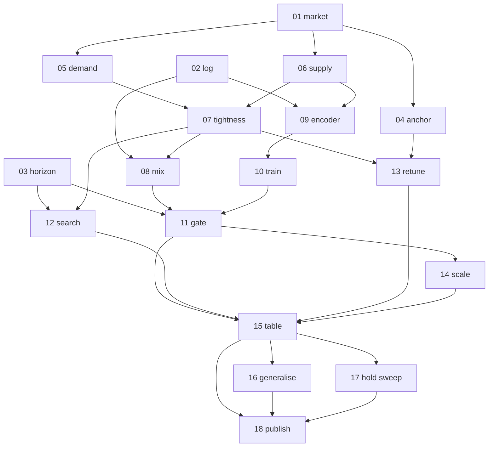

# Implementation report — jepa-replenishment-v2

- **Feature:** [PRD.md](PRD.md)
- **Started:** 2026-09-29T17:25:53Z
- **Last updated:** 2026-10-02T06:55:01Z
- **Parallelism cap:** 1
- **Integration branch:** `feat/jepa-replenishment`
- **Harness:** cursor
- **Isolation:** inplace
- **Runner model:** inherit → (orchestrator)
- **Implementer model:** grok → `grok-4.7-xhigh` (user pin; models.md preferred `cursor-grok-4.6-xhigh`)
- **Firewall:** degraded (Cursor orchestrator dispatches `issue-implementer` in-process)
- **Preflight:** working tree cleaned by committing PRD + 18 tickets (`6d572df`). `uv` 0.11.13. `/implement`, `/tdd`, `/code-review` present. Catalog/K_active already in ticket 05; user confirmed no bump.

## Status

| ID | Title | Wave | Status | Agent ID | Worktree SHA | Integrated SHA | Started | Finished | Notes |
|---|---|---|---|---|---|---|---|---|---|
| 01 | Correct market seasonal cycle | 1 | committed | c241745b-d2d3-4741-9ac8-300322eb6a80 | 4f06c1b | 4f06c1b | 2026-09-29T17:26:30Z | 2026-09-29T17:56:07Z | inplace; only regression digest rebaselined |
| 02 | Transition log filled quantity and manifest | 1 | committed | 6e279989-a50f-4f6c-9a48-c9eae972c662 | e070fbb | e070fbb | 2026-09-29T17:56:07Z | 2026-09-29T18:31:35Z | filled_qty vs requested_qty; age profile; manifest |
| 03 | Planner horizon and terminal value | 1 | committed | b14f7faf-bff9-40ab-8975-6e54a162f3e5 | d3e1b6b | d3e1b6b | 2026-09-29T18:31:35Z | 2026-09-29T19:01:12Z | horizon_multiple=4 + terminal value |
| 04 | Level the textbook anchor | 2 | committed | 993c606e-dd39-44d4-b1de-3e0f3a1063b3 | 099dace | 099dace | 2026-09-29T19:01:12Z | 2026-09-29T20:31:54Z | true unit cost; shared routing/floor/pilot |
| 05 | Episode distribution demand side | 2 | committed | 21711799-6ed3-4972-aa2f-0486a6fe6105 | 20bfe94 | 20bfe94 | 2026-09-29T20:31:54Z | 2026-09-29T21:16:23Z | catalog 750; K_active 1–30; lifecycle sampled |
| 06 | Episode distribution supply side | 2 | committed | b226f4b7-342b-4df8-a9ba-d1d1f904f6f2 | 375c618 | 375c618 | 2026-09-29T21:16:23Z | 2026-09-29T21:47:18Z | 3 factories/SKU; markup; lag 2–6 |
| 07 | Binding tightness | 3 | committed | 7be1073d-a58c-490b-8436-f813835147e3 | 5f81435 | 5f81435 | 2026-09-29T21:47:18Z | 2026-09-29T22:27:45Z | capacity LogU(0.5,6); cash LogU(0.02,0.8) |
| 08 | Behaviour mixture | 4 | committed | bd2b84f3-6fb7-4b40-a520-8fda345321d4 | 3add495 | 3add495 | 2026-09-29T23:02:45Z | 2026-09-29T23:56:10Z | 4 families + exploratory/never/8× over-order |
| 09 | Encoder inputs | 3 | committed | a8c2a003-b272-44ee-b4a4-bf97aa002e92 | d4f0d56 | d4f0d56 | 2026-09-29T22:27:45Z | 2026-09-29T23:02:45Z | 28-tick window; 10-slot profile; lag feature |
| 10 | Training rebuild | 4 | committed | 899433b5-ee35-40ab-9cc3-443bac68b4e0 | 18be53a | 18be53a | 2026-09-29T23:56:10Z | 2026-09-30T00:39:56Z | real epochs; holdout; early stop; profile probes |
| 11 | Rollout horizon and publish gate | 5 | committed | 49b99f1a-b2d3-4458-a27a-5c11b19a4756 | cef6911 | cef6911 | 2026-09-30T12:53:29Z | 2026-09-30T13:29:22Z | unroll at planning horizon; gate vs OLS |
| 12 | Factored search and density priority | 4 | committed | cba33a24-42b6-4be4-9e84-4da3bc0f9e83 | 6fda2d4 | 6fda2d4 | 2026-09-30T00:39:56Z | 2026-09-30T07:14:31Z | reconciled on resume; commit landed while session was down |
| 13 | Retune studies on corrected world | 4 | committed | 8608cb2b-a120-47a7-b926-b54b7f550b87 | 0cdaa35 | 0cdaa35 | 2026-09-30T07:14:31Z | 2026-09-30T12:53:29Z | all five rates beat default; CI above zero |
| 14 | Model capacity and data scaling | 6 | committed | 3620e81b-9e71-4f94-b671-7b8d3bfe5aac | 6f44e2a | 6f44e2a | 2026-09-30T13:29:22Z | 2026-09-30T15:26:05Z | published 256×4 / 683k params; resumed to commit |
| 15 | Comparison table rebuild | 7 | committed | 5ecfc60c-8296-4238-b536-a0d385d7c1ad | 365a3f3 | 365a3f3 | 2026-09-30T15:26:05Z | 2026-09-30T16:11:57Z | floors, oracle ceiling, permutation arm; gate unchanged |
| 16 | Generalisation protocols | 8 | committed | af50cc92-8a9d-48a9-bf1b-22e9b092bbb3 | 0ce5e2d | 0ce5e2d | 2026-09-30T16:11:57Z | 2026-09-30T16:56:23Z | disjoint SKUs; three seed ranges; gate unchanged |
| 17 | Holding-rate sweep | 8 | committed | 88d9f3de-e5f9-483b-adcf-0bc54b8b1f63 | 32e0309 | 32e0309 | 2026-09-30T16:56:23Z | 2026-09-30T17:45:45Z | five-rate sweep; identical orders raise |
| 18 | Published run, paper, notebooks | 9 | committed | 568d7080-4c39-4d0d-9fae-e16fe18d184b | 314dc86 | 314dc86 | 2026-09-30T17:45:45Z | 2026-10-02T03:09:08Z | published eval exited 0, then the sweep refusal was traced to a crushed fill rate; correction follows |

## Dependency graph

## Wave plan

Cap 1 splits each original wave into sequential one-issue sub-waves. Every issue: grok → `grok-4.7-xhigh`.

1. 01 market · 02 log · 03 planner horizon
2. 04 anchor · 05 demand · 06 supply
3. 07 tightness · 09 encoder
4. 08 mix · 10 train · 12 search · 13 retune
5. 11 rollout gate
6. 14 scale-up
7. 15 comparison table
8. 16 generalisation · 17 holding sweep
9. 18 run, paper, notebooks

## Activity log

- 2026-09-29T17:25:53Z preflight pass; dirty tree was PRD + tickets
- 2026-09-29T17:26:20Z committed spec `6d572df`
- 2026-09-29T17:26:30Z dispatch 01 inplace
- 2026-09-29T17:27:15Z 01 agent id c241745b-d2d3-4741-9ac8-300322eb6a80
- 2026-09-29T17:56:07Z 01 committed `4f06c1b` (inplace; worktree SHA == integrated SHA)
- 2026-09-29T17:56:07Z dispatch 02 inplace
- 2026-09-29T17:56:20Z 02 agent id 6e279989-a50f-4f6c-9a48-c9eae972c662
- 2026-09-29T18:31:35Z 02 committed `e070fbb`
- 2026-09-29T18:31:35Z dispatch 03 inplace
- 2026-09-29T18:32:00Z 03 agent id b14f7faf-bff9-40ab-8975-6e54a162f3e5
- 2026-09-29T19:01:12Z 03 committed `d3e1b6b`; wave 1 complete
- 2026-09-29T19:01:12Z dispatch 04 inplace
- 2026-09-29T19:01:40Z 04 agent id 993c606e-dd39-44d4-b1de-3e0f3a1063b3
- 2026-09-29T20:31:54Z 04 committed `099dace`
- 2026-09-29T20:31:54Z dispatch 05 inplace
- 2026-09-29T20:32:20Z 05 agent id 21711799-6ed3-4972-aa2f-0486a6fe6105
- 2026-09-29T21:16:23Z 05 committed `20bfe94`
- 2026-09-29T21:16:23Z dispatch 06 inplace
- 2026-09-29T21:16:50Z 06 agent id b226f4b7-342b-4df8-a9ba-d1d1f904f6f2
- 2026-09-29T21:47:18Z 06 committed `375c618`; wave 2 complete
- 2026-09-29T21:47:18Z dispatch 07 inplace
- 2026-09-29T21:47:40Z 07 agent id 7be1073d-a58c-490b-8436-f813835147e3
- 2026-09-29T22:27:45Z 07 committed `5f81435`
- 2026-09-29T22:27:45Z dispatch 09 inplace
- 2026-09-29T22:28:10Z 09 agent id a8c2a003-b272-44ee-b4a4-bf97aa002e92
- 2026-09-29T23:02:45Z 09 committed `d4f0d56`; wave 3 complete
- 2026-09-29T23:02:45Z dispatch 08 inplace
- 2026-09-29T23:03:10Z 08 agent id bd2b84f3-6fb7-4b40-a520-8fda345321d4
- 2026-09-29T23:56:10Z 08 committed `3add495`
- 2026-09-29T23:56:10Z dispatch 10 inplace
- 2026-09-29T23:56:40Z 10 agent id 899433b5-ee35-40ab-9cc3-443bac68b4e0
- 2026-09-30T00:39:56Z 10 committed `18be53a`
- 2026-09-30T00:39:56Z dispatch 12 inplace
- 2026-09-30T00:40:20Z 12 agent id cba33a24-42b6-4be4-9e84-4da3bc0f9e83
- 2026-09-30T07:14:31Z resume reconcile: 12 already in done/ and on BASE as `6fda2d4`; no worktree salvage
- 2026-09-30T07:14:31Z dispatch 13 inplace
- 2026-09-30T07:15:00Z 13 agent id 8608cb2b-a120-47a7-b926-b54b7f550b87
- 2026-09-30T12:53:29Z 13 committed `0cdaa35`; wave 4 complete
- 2026-09-30T12:53:29Z dispatch 11 inplace
- 2026-09-30T12:54:00Z 11 agent id 49b99f1a-b2d3-4458-a27a-5c11b19a4756
- 2026-09-30T13:29:22Z 11 committed `cef6911`; wave 5 complete
- 2026-09-30T13:29:22Z dispatch 14 inplace
- 2026-09-30T13:30:00Z 14 agent id 3620e81b-9e71-4f94-b671-7b8d3bfe5aac
- 2026-09-30T15:23:40Z 14 returned without a commit; working tree still has the capacity changes. Resume the same agent.
- 2026-09-30T15:24:00Z 14 resume sent to 3620e81b-9e71-4f94-b671-7b8d3bfe5aac
- 2026-09-30T15:26:05Z 14 committed `6f44e2a`; wave 6 complete
- 2026-09-30T15:26:05Z dispatch 15 inplace
- 2026-09-30T15:26:30Z 15 agent id 5ecfc60c-8296-4238-b536-a0d385d7c1ad
- 2026-09-30T16:11:57Z 15 committed `365a3f3`; wave 7 complete
- 2026-09-30T16:11:57Z dispatch 16 inplace
- 2026-09-30T16:12:20Z 16 agent id af50cc92-8a9d-48a9-bf1b-22e9b092bbb3
- 2026-09-30T16:56:23Z 16 committed `0ce5e2d`
- 2026-09-30T16:56:23Z dispatch 17 inplace
- 2026-09-30T16:56:50Z 17 agent id 88d9f3de-e5f9-483b-adcf-0bc54b8b1f63
- 2026-09-30T17:45:45Z 17 committed `32e0309`; wave 8 complete
- 2026-09-30T17:45:45Z dispatch 18 inplace
- 2026-09-30T17:46:10Z 18 agent id 568d7080-4c39-4d0d-9fae-e16fe18d184b
- 2026-10-01T01:21:05Z 18 connection failed; no `18:` commit; uncommitted paper/notebook/code edits remain. Resume same agent.
- 2026-10-01T01:21:30Z 18 resume accepted for 568d7080-4c39-4d0d-9fae-e16fe18d184b
- 2026-10-01T14:23:37Z 18 resume died: connection failed repeatedly. Salvage commit `d4874c8` (`18: WIP salvage after interrupted run`). Issue file still in issues/. Marked blocked. No second implementer launched.
- 2026-10-02T00:54:29Z eval exited 0 after recording the sweep refusal. Commit `314dc86` moved issue 18 to done/.
- 2026-10-02T06:55:01Z fill rate 0.0015 traced to quantity-weighting the over-order arm. Textbook fill is 0.9996. Corrected `_fill_ratio` and a stale-checkpoint refresh in the rollout gate. Re-run eval before treating the paper tables as the corrected run.

## Outstanding follow-ups

- LLM world-builder math defaults still use `Normal(0, 0.01)` demand shock and `Constant(1.001)` trend (from 01).
- A zero `min_value` / `demand_factor_min` can still emit a zero factor; `flat_world` depends on that floor (from 01).
- Issue 09 should feed the arrival-age profile into the encoder instead of the sum (from 02; already in ticket 09).
- Issue 08 should extend the manifest's behaviour mixture when sampled hyperparameters land (from 02; already in ticket 08).
- Issue 18 should regenerate the paper, which still says the model is conditioned on the ration grant (from 02; already in ticket 18).
- Paper method still describes imagined profit without the terminal credit (from 03; ticket 18).
- World-model training unroll is still `delivery_lag`; aligning it with the planning horizon is ticket 11 (from 03).
- Paper still records a study that sampled routing and the floor; ticket 13 retunes, ticket 18 regenerates (from 04).
- Notebook 05a still displays that historical study; new studies omit those columns (from 04).
- Imagined planner steps still price the cheapest offer because the offer book is not rolled forward (from 04).
- ADR 0025 still says tuning episodes ship `K_active = 5` (from 05; ticket 18 consistency pass).
- Non-numeric stage multiplier treated as 1 so the clock does not draw from `world_rng` (from 05).
- Ticket 09 still fits one lag; mixed lags in an unpinned log are clipped to the episode nominal window (from 06; ticket 09).
- Cheapest-first clips orders to the published offer, so study policies can still show allocation fill rate of 1 (from 06).
- Notebook 05's saved per-seed HTML preview still predates tightness columns (from 07).
- Probe targets are still the summed next in-transit quantity (from 09; ticket 10).
- Imagined pipeline aging uses the nominal lead, so a slower supplier's cohort can leave the profile early (from 09).
- Published parquet under `runs/` is not regenerated; next collect writes the new mixture (from 08; ticket 18).
- Non-zero-fill bar is `> 0.18` on a short coverage log, not the published 365-tick collector (from 08).
- `compare_synthetic` still does not score the permutation arm; that table is ticket 15 (from 12).
- Ticket 17 ceilings live in gitignored `runs/jepa-replenishment/tuning/order_up_to_holding_*` (from 13).
- Paper run record lists the new studies; in-distribution and retarget tables are still the previous synthetic eval (from 13; ticket 18).
- Current model width still loses to OLS at a reduced budget; the gate test expects that (from 11). Ticket 14 scales capacity so the published model can clear the gate.
- On the 112-episode measurement log the published latent model’s mean rollout R² is 0.124 against 0.358 for OLS, so the publish gate may still refuse a profit table until a full log is fit (from 14). Ticket 15 left that gate unchanged.
- A full-log fit is still required before a profit table can be published (from 15; ticket 18).
- Ticket 18 still lists a harsher disruption as future work in the paper (from 16).
- `docs/jepa-replenishment.md` and `paper.py` still describe the single-rate retarget (from 17; ticket 18). The salvage commit `d4874c8` updates `paper.py` but the published eval never finished, so the paper numbers are not a completed run.
- Published collect (896/896) and fit succeeded. Eval was killed twice (SIGTERM): first after ~12 hours with no arm log, then after the never-order and random-cover arms at holding rate 0.01. Checkpoints and the transition log remain under `runs/jepa-replenishment/`.
- 2026-10-01T18:45:46Z the six-worker eval finished the three protocols and the five-rate sweep, then exited 1: `UnfalsifiableTransfer` — the frozen planner's order sequence is identical across holding rates, so the transfer curve was refused.
- 2026-10-02T00:54:29Z a later eval exited 0 and wrote the refusal into the paper (`314dc86`). The learned arms were dropped as collinear with never-order.
- 2026-10-02T06:55:01Z the identical orders were the fill rate. `_fill_ratio` quantity-weighted the over-order arm (requested ~917, filled ~0.6) and stored 0.0015. Textbook orders fill at 0.9996. With that rate the planner orders, and holding rates 0.005 and 0.1 do not place the same sequence on a short holdout seed. Eval must be re-run before the paper's profit tables are the corrected run.

## Resume instructions

Re-run `/implement-issues` with `.scratch/jepa-replenishment-v2/`. Phase 2 reconciles from this file, `done/`, and `<id>:` commits on `feat/jepa-replenishment`.

Issue 18 is in `done/` and `314dc86` is the published-run commit. The profit tables in that commit were produced with fill rate 0.0015, so the learned planner matched never-order and the sweep refusal is not a transfer result. Re-run `eval` on the corrected fill rate, then regenerate `docs/jepa-replenishment.md` with `render_paper`.
