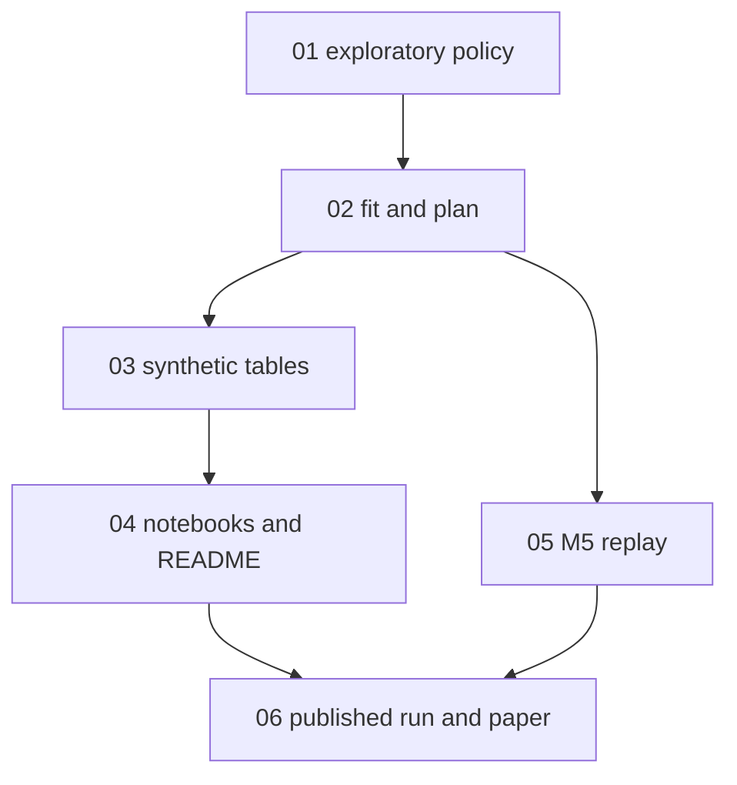

# Implementation report: jepa-replenishment

- **Feature:** jepa-replenishment
- **PRD:** [PRD.md](PRD.md)
- **Started:** 2026-09-27T06:32:22Z
- **Last updated:** 2026-09-27T10:54:58Z
- **Parallelism cap:** 1
- **Integration branch:** `feat/jepa-replenishment`
- **Harness:** cursor
- **Isolation:** inplace
- **Runner model:** inherit (in-process; no wave-runner Task)
- **Implementer model:** `grok-4.7-xhigh` (user: Grok 4.7 Xhigh; raw slug, passed through)
- **Firewall:** degraded
- **Preflight assumptions:**
  - User named the feature folder, `cap=1`, and Grok 4.7 Xhigh. No per-issue `Model:` or `Complexity:` lines, so every implementer uses `grok-4.7-xhigh`.
  - `cap=1` resolves isolation to `inplace`. Commits land directly on `feat/jepa-replenishment`.
  - Cursor permission note (stated once): implementers will `git add` / `git commit` on this branch. No worktree, cherry-pick, or `git push`.
  - Consistency scan: `src/jepa/`, notebooks `09`–`11`, `README.md`, and `docs/jepa-replenishment.md` are not gitignored. `runs/jepa-replenishment/` and `data/m5*` are gitignored, matching the PRD. No direct PRD contradictions.
  - Dependency wave {03, 05} is split by the cap into consecutive sub-waves, 03 then 05 (filename order). 04 stays after that split even though it unblocks when 03 commits.

## Status

| ID | Title | Wave | Status | Agent ID | Worktree SHA | Integrated SHA | Started | Finished | Notes |
|---|---|---|---|---|---|---|---|---|---|
| 01-exploratory-policy-and-transition-log | Exploratory Policy and synthetic transition log | 1 | committed | b26ea3f0-650c-488c-b665-cb33ffc7b62c | bd72d338debde06dcc70fcdfc65237a8448b6c9c | bd72d338debde06dcc70fcdfc65237a8448b6c9c | 2026-09-27T06:33:00Z | 2026-09-27T07:20:05Z | inplace; 1147 passed, 9 skipped |
| 02-fit-and-plan | Fit the latent model and plan with it | 2 | committed | 5aef8522-c545-43ad-a988-9ce71c6995a2 | 761cac4ad8dc11b6e5cf0bada55b2a9c3cf77c99 | 761cac4ad8dc11b6e5cf0bada55b2a9c3cf77c99 | 2026-09-27T07:20:05Z | 2026-09-27T08:11:23Z | inplace; 1156 passed |
| 03-synthetic-comparison-tables | Synthetic comparison tables | 3 | committed | abed20a0-dbeb-4d3d-b6a4-09a0bbef1e45 | df72fee3122ae45f3d5ce69c9e2be9a98883697f | df72fee3122ae45f3d5ce69c9e2be9a98883697f | 2026-09-27T08:11:23Z | 2026-09-27T08:40:00Z | inplace; compare_synthetic smoke tables |
| 05-m5-replay-exam | M5 replay exam | 4 | committed | decfe3ca-2b47-48bf-a094-006173aef020 | bf79a677dea9c58b98587c6be37b27f8935c3a0f | bf79a677dea9c58b98587c6be37b27f8935c3a0f | 2026-09-27T08:40:00Z | 2026-09-27T09:24:40Z | inplace; 1177 passed, 9 skipped |
| 04-notebooks-and-readme | Training notebook, results notebook, and README commands | 5 | committed | 99e077c8-8235-4298-811a-07bcfcb8506c | 990c7b9bef4da6a0c4e078f0a1dc075d6d0b542a | 990c7b9bef4da6a0c4e078f0a1dc075d6d0b542a | 2026-09-27T09:24:40Z | 2026-09-27T09:54:50Z | inplace; 1183 passed, 9 skipped |
| 06-published-run-and-paper | Published synthetic run and paper | 6 | committed | b958aa23-34b0-4502-824f-a0d0bb085410 | 9dcd10c2108629103cc661a1dba83a5fd4dfaa35 | 9dcd10c2108629103cc661a1dba83a5fd4dfaa35 | 2026-09-27T09:54:50Z | 2026-09-27T10:54:58Z | inplace; both pass booleans fail; M5 absent; 1191 passed, 9 skipped |

## Dependency graph

## Wave plan

1. `01-exploratory-policy-and-transition-log` — Grok 4.7 Xhigh → `grok-4.7-xhigh`
2. `02-fit-and-plan` — Grok 4.7 Xhigh → `grok-4.7-xhigh`
3. `03-synthetic-comparison-tables` — Grok 4.7 Xhigh → `grok-4.7-xhigh` (cap split)
4. `05-m5-replay-exam` — Grok 4.7 Xhigh → `grok-4.7-xhigh` (cap split)
5. `04-notebooks-and-readme` — Grok 4.7 Xhigh → `grok-4.7-xhigh`
6. `06-published-run-and-paper` — Grok 4.7 Xhigh → `grok-4.7-xhigh`

## Activity log

- 2026-09-27T06:32:22Z preflight pass: harness=cursor, branch=feat/jepa-replenishment, clean tree, uv 0.11.13, /implement + tdd + code-review present, isolation=inplace, firewall=degraded.
- 2026-09-27T06:33:00Z wave 1 marked in-progress before dispatch: 01-exploratory-policy-and-transition-log.
- 2026-09-27T06:34:00Z dispatched 01-exploratory-policy-and-transition-log agent b26ea3f0-650c-488c-b665-cb33ffc7b62c model grok-4.7-xhigh isolation=inplace.
- 2026-09-27T07:20:05Z 01-exploratory-policy-and-transition-log committed inplace bd72d338debde06dcc70fcdfc65237a8448b6c9c; issue file in done/.
- 2026-09-27T07:20:05Z wave 2 marked in-progress before dispatch: 02-fit-and-plan.
- 2026-09-27T07:20:30Z dispatched 02-fit-and-plan agent 5aef8522-c545-43ad-a988-9ce71c6995a2 model grok-4.7-xhigh isolation=inplace.
- 2026-09-27T08:11:23Z 02-fit-and-plan committed inplace 761cac4ad8dc11b6e5cf0bada55b2a9c3cf77c99; issue file in done/.
- 2026-09-27T08:11:23Z wave 3 marked in-progress before dispatch: 03-synthetic-comparison-tables.
- 2026-09-27T08:11:40Z dispatched 03-synthetic-comparison-tables agent abed20a0-dbeb-4d3d-b6a4-09a0bbef1e45 model grok-4.7-xhigh isolation=inplace.
- 2026-09-27T08:40:00Z 03-synthetic-comparison-tables committed inplace df72fee3122ae45f3d5ce69c9e2be9a98883697f; issue file in done/.
- 2026-09-27T08:40:00Z wave 4 marked in-progress before dispatch: 05-m5-replay-exam.
- 2026-09-27T08:40:20Z dispatched 05-m5-replay-exam agent decfe3ca-2b47-48bf-a094-006173aef020 model grok-4.7-xhigh isolation=inplace.
- 2026-09-27T09:24:40Z 05-m5-replay-exam committed inplace bf79a677dea9c58b98587c6be37b27f8935c3a0f; issue file in done/.
- 2026-09-27T09:24:40Z wave 5 marked in-progress before dispatch: 04-notebooks-and-readme.
- 2026-09-27T09:25:00Z dispatched 04-notebooks-and-readme agent 99e077c8-8235-4298-811a-07bcfcb8506c model grok-4.7-xhigh isolation=inplace.
- 2026-09-27T09:54:50Z 04-notebooks-and-readme committed inplace 990c7b9bef4da6a0c4e078f0a1dc075d6d0b542a; issue file in done/.
- 2026-09-27T09:54:50Z wave 6 marked in-progress before dispatch: 06-published-run-and-paper.
- 2026-09-27T09:55:10Z dispatched 06-published-run-and-paper agent b958aa23-34b0-4502-824f-a0d0bb085410 model grok-4.7-xhigh isolation=inplace.
- 2026-09-27T10:26:09Z published collect, fit, both 150-trial studies, and holdout eval finished exit 0 under runs/jepa-replenishment/.
- 2026-09-27T10:54:58Z 06-published-run-and-paper committed inplace 9dcd10c2108629103cc661a1dba83a5fd4dfaa35; issue file in done/.
- 2026-09-27T10:54:58Z final cleanup: no owned issue-* worktrees. All six issues committed.

## Outstanding follow-ups

- M5 replay was not run. `docs/jepa-replenishment.md` has the notebook command and the ADR 0028 slice rule, no result rows, and `PINNED_ITEM_IDS` is empty until a quality report exists.
- The runner publishes shop `list_prices` before `decide` and does not apply the action price, so the M5 exam writes that day's price onto the shop before each tick.

## Resume instructions

Re-run `/implement-issues` with `.scratch/jepa-replenishment/` and the same cap. Phase 2 reconciles from this file, `issues/done/`, `<id>:` commits on `feat/jepa-replenishment`, and Agent IDs.
