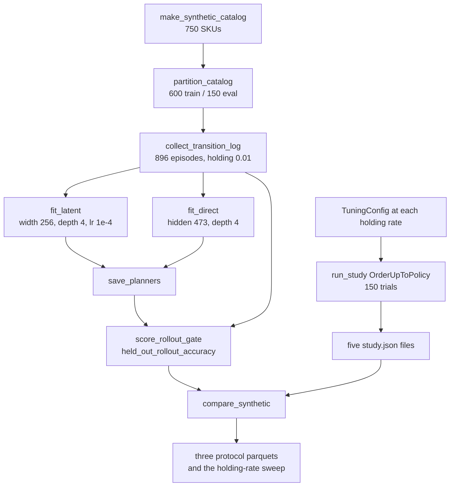
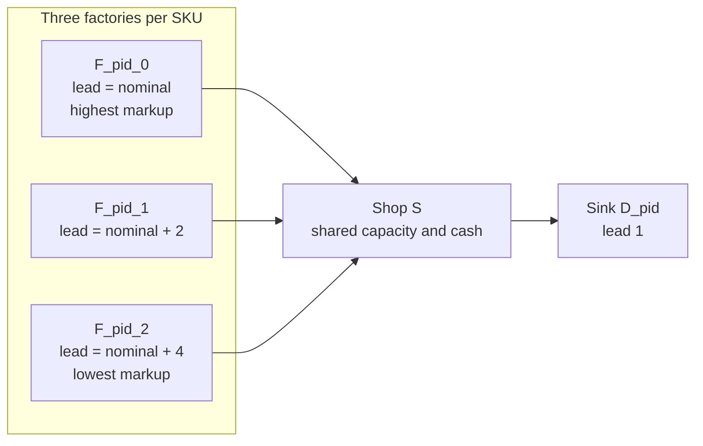
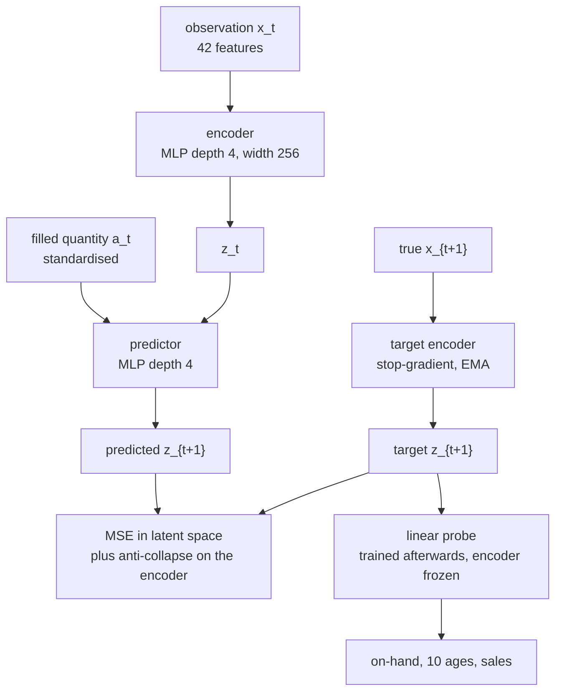
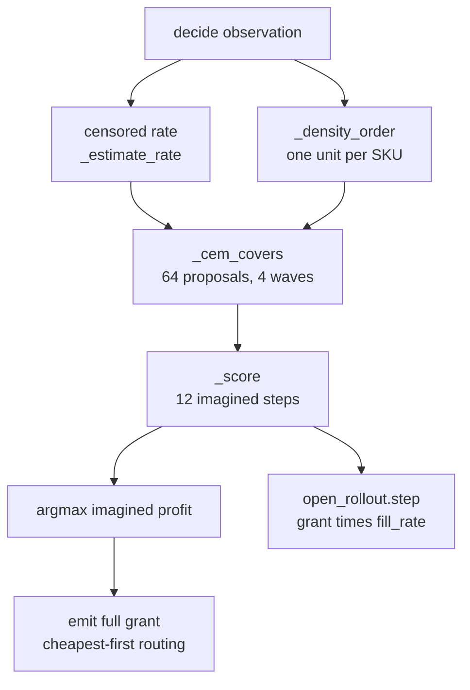

# Methodology

This section is the procedure that produced the published run. A reader with the repository can rebuild the worlds, the log, the networks, the planner, and the tables by calling the functions named below. Commands are the ones in `src/jepa/commands.py`. Defaults that the published command does not override are the defaults of those functions on the revision that wrote the draft.

The published commands are:

```bash
uv run python -m src.jepa collect --episodes-each 64 \
  --output runs/jepa-replenishment/log/transitions.parquet
uv run python -m src.jepa fit \
  --log runs/jepa-replenishment/log/transitions.parquet \
  --output runs/jepa-replenishment/checkpoints
uv run python -m src.jepa tune --holding-rate 0.005 --trials 150 \
  --output-dir runs/jepa-replenishment/tuning
# repeated for holding rates 0.01, 0.02, 0.05, and 0.1
uv run python -m src.jepa eval \
  --checkpoints runs/jepa-replenishment/checkpoints \
  --log runs/jepa-replenishment/log/transitions.parquet \
  --tuning-dir runs/jepa-replenishment/tuning \
  --output runs/jepa-replenishment/synthetic
```

`collect` calls `collect_transition_log`. `fit` calls `fit_latent` and `fit_direct`, then `save_planners`. `tune` calls `run_study` and `confirm_top_k` on `order_up_to_space`. `eval` calls `publish_synthetic_comparison`. Optional `python -m src.jepa scale` writes capacity and data curves; those files are not committed.



## 1. The shop the policies control

Every synthetic episode is one directed acyclic graph built by `_build_tuning_graph_scenario` inside `sample_episode`.

- Several `FactoryNode`s, three per active product, ids `F_<pid>_0`, `F_<pid>_1`, `F_<pid>_2`. Each factory produces one product.
- One `IntermediateNode` with id `S`. This is the only controlled shop. It carries every active product, holds one shared capacity pool, and holds one cash account.
- One `DemandSinkNode` per active product, id `D_<pid>`. Sinks are the only source of new demand. Each sink is bound to one product.

Edges run from each factory to `S`, with a lead time that depends on the supplier, and from `S` to each sink at lead time 1. The region is `US`. The episode starts on 2024-01-01 and lasts 365 ticks, one tick per day. Factories in the log and in evaluation are overridden to `StaticFactoryPolicy` by `_factory_overrides`: they produce `capacity_per_tick` each tick at the node's unit cost and do not learn.

The shop's action, returned by every buyer in this study, is a dict with `order`, `list_price`, `min_order_imposed`, and `promotions`. `list_price` is copied from `base_prices`. Promotions are empty. The minimum-order floor imposed by the buyer is zero. Inventory position, wherever a rule needs it, is on-hand plus in-transit. Engine allocation stays `execute_buy`. The learned buyer does not replace it.

`Runner.run` advances the graph one tick at a time. At decision time the shop has not yet received this tick's fills, which is why an arrival-age profile records age 0 as empty (`arrival_age_profile`). Common random numbers come from deriving sub-seeds with `_sim_derive_seed` and from giving every sink a draw for every catalog product so that the world stream does not depend on which products are active (ADR 0003, `DemandSinkNode.demand_target`).

## 2. Catalog

`make_synthetic_catalog` builds `SYNTHETIC_CATALOG_SIZE = 750` wares. Index `i` runs from 0 to 749 and `span = 749`.

| Field | Formula |
| --- | --- |
| `product_id` | `P{i:04d}` via `load_catalog` |
| `demand_mean` | `0.5 * 80 ** (i / span)`, so 0.5 at the first SKU and 40 at the last |
| `demand_cv` | `0.05 + 0.45 * ((i * 17) % n) / span` |
| `margin` | `0.08 + 0.67 * ((i * 13) % n) / span` |
| `unit_cost` | `4 + (i % 11)` |
| `base_price` | `unit_cost / (1 - margin)` |
| `tempo` | `0.25 + 3.75 * ((i * 19) % n) / span` |
| seasonality | `all_season` |
| stage-change probabilities | canonical base rates times `tempo` |

Base stage rates are introduction 0.012, growth 0.012, maturity 0.01, decline 0.015, dead 0.003. Seasonality `all_season` is mapped to every month, so `Market.season_factor` returns `peak_factor` (1.2) on every tick. The seasonal swing in this study is the sine cycle in section 4, not the month table.

`partition_catalog` holds out one fifth of the wares, strided through product-id order. With 750 wares that is 150 evaluation SKUs and 600 training SKUs, matching the manifest. The stride is `len / n_eval`, and the chosen index in each stride is at phase 0.6 of the stride, so the holdout is spread across the demand range rather than taken from the high-demand tail. Training episodes and the in-distribution and unseen-disruption protocols receive the training list. The unseen-SKU protocol receives the evaluation list. `catalog_identity` is the SHA-256 of the ware records. The published manifest records training identity `8e66d1343f47b8e4cf65894deaf0f7ef2db4ee9f322bbf5e3f8a9e49ed8aca72` and evaluation identity `971cb35429d8611d7c4ded34e790b4d16b9672bbf08871e59f39e4693bcb3911`.

## 3. One episode

`sample_episode(catalog, config, episode_seed)` is pure: the same catalog, `TuningConfig`, and seed rebuild the same `TuningEpisodeSpec`. The published shape is `TuningConfig()` except where a protocol sets `holding_rate` or a caller pins a knob. Unpinned, the config is:

- `episode_length = 365`
- `K_active = None`, so assortment size is drawn
- `K_min = 1`, `K_max_episode = 30`, `K_catalog = 750`
- `delivery_lag = None`, so the nominal lag is drawn
- `capacity_dist = None` and `balance_dist = None`, so both pools come from tightness
- `init_stock_pct_dist = Uniform(0.2, 1.0)`
- `holding_rate = 0.01` unless the protocol replaces it
- `order_fee = 50`

Sub-seeds are derived for assortment, capacity, balance, world, init stock, tightness, delivery lag, supply, and lifecycle. Assortment size uses `(episode_seed * 0x27D4EB2F + 9)` masked to 32 bits, then `Random.randint(K_min, K_max)`. The active set is a sample without replacement, sorted back into catalog order.

Opening inventory is `capacity * init_stock_pct`, split evenly across the active products. `sample_episode_lifecycle` draws a fresh stage table unless the caller passes one. Dead-stage probability is uniform on `[0, 0.008]`; other stages are uniform on `[0.008, 0.03]`; a scale uniform on `[0.5, 1.5]` multiplies any ware that already authors its own rates. Initial stage is drawn per SKU from the five canonical stages. Stage demand multipliers, from `default_market_params`, are introduction 0.7, growth 1.5, maturity 1.0, decline 0.2, dead 0.05.

### Shelf and cash

`_pools_from_tightness` sizes the two pools from the active wares. Expected demand per tick is the ware's `demand_mean`, or 5 if that field is missing. Capacity tightness is log-uniform on `[0.5, 6]`. Cash tightness is log-uniform on `[0.02, 0.8]`. They are separate draws from the same `tightness` stream. A single factor cannot do both jobs: on a 365-day episode, cash equal to a year's demand would be about twenty times a two-week shelf, and cash would never be what stops an order.

```
cover_fraction = 14 / episode_length
capacity = round(tightness * (sum of daily demand) * episode_length * cover_fraction)
opening_cash = cash_tightness * (sum of daily demand * episode_length * unit_cost)
```

At tightness 1 the shelf holds 14 ticks of expected demand. The published log reports the fraction of transition rows in which a constraint actually stopped a short order (`state_coverage`): low inventory (on-hand 0) 0.418, high inventory (shelf at least half full) 0.207, capacity-bound ticks 0.023, cash-bound ticks 0.384. Cash binds often. The shelf's capacity constraint binds rarely. Both fractions are properties of the behaviour mixture, not of the learned buyer.

### Suppliers

`_supplier_plan` builds three suppliers per SKU from a stream mixed with the product id. Index 0 is fastest and dearest. Lead times are `nominal_lag + (0, 2, 4)`. The nominal lag is an integer from 2 through 6 (`_nominal_delivery_lag`), so an edge lead is between 2 and 10. That is why the arrival-age profile has 10 slots (`ARRIVAL_AGE_SLOTS`).

Production per tick and opening stock, summed across the three suppliers, are `Uniform(0.15, 1.25)` and `Uniform(0, 4)` days of that SKU's expected demand, then split by random weights on `[0.4, 1]`. The slow supplier's markup over catalog unit cost is uniform on `[0.05, 0.25]`. Each step faster adds another uniform draw on `[0.10, 0.35]`. `list_price = unit_cost * (1 + slow_markup + steps_faster * premium)`. Factories start with that opening inventory and produce the planned quantity per tick. They can stock out. An order is not guaranteed to arrive in full, and the cheaper offer is slower.



## 4. Demand

`default_market_params` sets the regional process. `Market.update_market` advances the stored level. The seasonal cycle is not part of that update (ADR 0030). For each region, in order, the level is

```
level <- clamp(level * trend + Normal(0, 0.02), 0.2, 2.0)
```

`trend` is redrawn from `Uniform(0.997, 1.003)` every 20 steps, including step 0, after the per-region updates. Supply state is shocked by `Normal(0, 0.01)` plus `0.7` times the demand shock, then clamped to the same interval. Disruptions from `EventEngine` land on the stored level.

`Market.demand_multiplier` reads the level and applies the cycle:

```
regional = max(0.1, level) * (1 + 0.3 * sin(2 * pi * step / 365))
multiplier = season_factor * regional
```

`DemandSinkNode.demand_target` draws one base demand per catalog ware from that ware's `Uniform(mean * (1 - cv * sqrt(3)), mean * (1 + cv * sqrt(3)))`, keeps the draw for the sink's own product, and returns

```
max(0, int(base * multiplier * stage_factor))
```

The other draws exist so every sink consumes `len(catalog)` random numbers. Sales observed by the shop are what the sink could buy given the shop's on-hand stock. The censored-sales estimator `_estimate_rate` is the arithmetic mean of those observed sales over the last `demand_window` ticks. It does not impute lost sales. Textbook rules respond to censoring by lengthening the safety horizon when `_has_stockout` finds a tick where sales equal pre-settlement inventory and sales are positive. The learned planner calls `_estimate_rate` and does not call `_has_stockout`.

Default disruption, used for the log and for every protocol except unseen disruption, is `default_disruption_params`: event probability 0.05, types `natural_disaster` and `economic_crisis`, region `US`, severity 0.01, duration 3 days. The harsh regime is `harsh_disruption_params`: probability 0.2, severity 0.2, duration 21, and the additional types `pandemic` and `political_unrest`.

## 5. Behaviour mixture and the transition log

`collect_transition_log` writes the training data. The published call uses `episodes_each = 64` and `LOG_SEED_OFFSET = 14_000_000`. `behavior_schedule` lays the arms in contiguous seed blocks:

| Order in `BEHAVIORS` | Policy | Episodes | Seeds in the published log |
| --- | --- | --- | --- |
| `order_up_to` | `OrderUpToPolicy` via `sample_textbook_policy` | 64 | 14000000–14000063 |
| `reorder_point` | `ReorderPointPolicy` | 64 | next block of 64 |
| `periodic_order_up_to` | `PeriodicOrderUpToPolicy` | 64 | next block |
| `periodic_reorder` | `PeriodicReorderPolicy` | 64 | next block |
| `exploratory` | `ExploratoryPolicy` | 64 | next block |
| `never_order` | `NeverOrderPolicy` | 64 | next block |
| `over_order` | `OverOrderPolicy` | 512 | through 14000895 |

`episodes_for` multiplies the over-order arm by `OVER_ORDER_WEIGHT = 8` because a competent cover orders and then waits, and an equal mixture was leaving too few non-zero fills to train an action-conditioned model. The published non-zero order fraction is 0.146410. Total episodes are 896. Holding rate is 0.01 on every episode. Disruption is the default regime. SKUs are drawn from the training partition only. `K` and the nominal lag are sampled, so the log is not a single assortment and not a single lead time. The manifest records `delivery_lag: null` and `K_active: null` for that reason. The git SHA stored on the manifest is `32e0309b468af938eab38c4de8109a1b80a1d543`.

`log_buyer` builds the policy and the hyperparameter row stored in the manifest sidecar.

- Textbook arms call `sample_textbook_policy`, which draws from the Optuna search space with a seeded trial, then `_reseed` pins `policy_rng` to the episode seed. Planning depth is the drawn `cover_horizon_ticks`.
- Exploratory depth is `sample_cover_horizon_ticks` on the same range, and it replaces `delivery_lag` inside the order-up-to target. The rate window stays `delivery_lag`.
- Never-order has depth 0 and emits an empty order.
- Over-order depth is `30 + sample_cover_horizon_ticks`, strictly above the textbook cover range of 1 through 30. Each tick it orders at least one unit. When cash covers the open shelf it orders `free space + planning_depth`, past what the shelf can hold, so the capacity clamp is reachable.

Search ranges in `src/tuning/search_spaces.py`, shared by the log mixture and by the later tuning studies:

| Parameter | Range |
| --- | --- |
| `cover_horizon_ticks` | integers 1–30 |
| `safety_lead_pct_of_lag` | 0–3 |
| `stockout_safety_bonus_pct_of_lag` | 0–2 |
| `Q` for the reorder-point family | integers 1–30 |
| `review_interval` for the periodic family | integers 1–14 |

`ExploratoryPolicy.decide` draws a cover from `{0, 1, 2, 4}` per SKU and a priority permutation, both from `policy_rng` only, so a different world seed does not change the cover sequence. The quantity before rationing is

```
target = round(cover * rate * horizon)
desired = max(0, target - on_hand - in_transit)
```

`_priority_ration` then grants units in priority order until free shelf space or cash is exhausted. Free space is capacity minus on-hand minus in-transit. The supplier is the cheapest direct offer (`cheapest_direct_supplier`).

### What a row contains

`_TransitionRecorder` wraps the buyer. `_record_episode` runs `Runner`, then `_annotate_steps` and `_transitions`.

At `decide`, `_snapshot` stores tick, on-hand, a placeholder in-transit profile, a 28-day sales window, cash, capacity, and `requested_qty` (the sum of quantities in the emitted order). After the tick, `_annotate_steps` overwrites `filled_qty` with the sum of `qty_filled` on purchases whose buyer is `S`, and overwrites `in_transit` with `arrival_age_profile`. A unit filled on an earlier tick stays in the profile while its age is strictly between 0 and its edge lead (`_edge_lead`). Age 0 stays 0 because decide runs before the fill.

`_transitions` emits one row per product for every pair of consecutive snapshots. The last tick of the episode has no next state and is dropped. The published log therefore has ticks 1 through 364. Columns are `episode_seed`, `behavior`, `tick`, `product_id`, `on_hand`, `in_transit`, `sales_window`, `cash`, `capacity`, `requested_qty`, `filled_qty`, `delivery_lag` (the episode's nominal lag), `next_on_hand`, `next_in_transit`, `next_sales`. Groups used later are `(episode_seed, product_id)` sorted by tick (`_groups`).

`_constraint_ticks` marks a tick capacity-bound when the request exceeded the fill and on-hand plus filled quantity is at least capacity, and cash-bound when the request exceeded the fill and the cash left after payment cannot buy another unit at the price paid. `_write_manifest` stores episode counts, seed span, catalog identities, both disruption dicts, protocol seed blocks, state coverage, the non-zero order fraction, and per-episode hyperparameters. Collects of at least 128 episodes stream to parquet (`_collect_streaming`) so the frame is not held twice in memory.

## 6. What the encoder is allowed to see

`sku_features` builds one vector per SKU. `feature_dim` is `1 + 10 + 28 + 3 = 42`. The layout is fixed; it does not grow when the sampled lag changes.

| Positions | Content | Source |
| --- | --- | --- |
| 0 | on-hand | decision snapshot |
| 1–10 | arrival-age profile, age 0 first | `arrival_age_profile`, width `ARRIVAL_AGE_SLOTS` |
| 11–38 | sales window, oldest first, left-padded with zeros | `padded_sales_window`, length `SALES_WINDOW = 28` |
| 39 | cash | shop cash, repeated on every SKU |
| 40 | capacity | shop capacity, repeated on every SKU |
| 41 | nominal delivery lead time | the row's `delivery_lag`, else the model's fallback |

The market multiplier, the disruption type, the calendar, the supplier identity, and the other SKUs' inventories are not features (`log_row_features` drops them). The 28-day window is longer than the longest edge lead of 10, so the window does not have to track the sampled lag.

The quantity target, `target_dim` = 12, is next on-hand, the next arrival-age profile (10 ages), and sales over the step (`_targets`). The planner later sums the profile when it needs a pipeline total (`_in_transit_units`).

## 7. Networks

Both models subclass `_ScaledDynamics`. Each stores the delivery lag, the unroll length, and population mean and standard deviation of features, actions, and targets, with standard deviations floored at `1e-6`. An action is standardised on its own. A buffer `fill_rate` defaults to 1 and is overwritten from the log (section 9).

`_mlp` stacks `depth` linear layers. ReLU sits between them and not after the last. Hidden width equals the output width of the latent modules.

### Latent model

`LatentDynamics` holds four modules.

| Module | Class | Input | Output | Trained by |
| --- | --- | --- | --- | --- |
| Online encoder | `_Encoder` | 42 | `embed_dim` | latent loss |
| Predictor | `_Predictor` | `embed_dim + 1` (code concatenated with the standardised filled quantity) | `embed_dim` | latent loss |
| Target encoder | a frozen copy of the encoder | 42 | `embed_dim` | exponential moving average |
| Probe | `_Probe`, one linear layer | `embed_dim` | 12 | probe loss only |

The published fit passes `embed_dim = 256` and `depth = 4` (`PUBLISHED_EMBED_DIM`, `PUBLISHED_DEPTH`). `parameter_count` on that model, including the frozen target encoder, is 683,276. The optimizer steps the online encoder and the predictor only (`trainable_parameter_count`). `fit_latent`'s own default stays the reduced model, width 32 and depth 2, which is the model the publish gate was originally measured against. The fit command replaces that default.



At planning time `_LatentRollout` encodes the decision-time observation once and then carries the predicted code. It does not re-encode a decoded inventory. Each `step` applies the predictor to the standardised granted quantity and decodes with the probe (`_as_quantities`).

### Direct model

`DirectDynamics` has no latent target and no moving-average encoder. `_DirectNet` maps the 42 features concatenated with the action through an MLP of the same depth onto the 12 quantities. `direct_hidden_matching` picks the hidden width whose parameter count is closest to the latent model's trainable count. For width 256 and depth 4 that width is `PUBLISHED_DIRECT_HIDDEN = 473`, and `parameter_count` is 474,904. The published fit uses learning rate `1e-4` for both.

`_DirectRollout` feeds predicted on-hand and predicted sales back into the observation and ages a pipeline with `_advance_observation`: the grant becomes age 1, older cohorts move up one tick, and a cohort whose next age is not below the nominal lead drops out. Cash, capacity, and lead time stay at their decision-time values. The decoded arrival-age profile is returned to the planner and is not written back into the next observation. The latent rollout does not need that hand-built pipeline, because the code is the state.

### Least squares and the oracle

`fit_least_squares_dynamics` fits one linear map by `torch.linalg.lstsq` (`_fit_ols`). The design matrix is the encoder features whose training standard deviation exceeds `1e-6`, the filled quantity, and a column of ones. Constant feature columns are dropped because the intercept already plays that role. The fit uses the latent model's training episodes. Rollout (`_LeastSquaresRollout`) uses the same observation advance as the direct model. Its `fill_rate` is the log ratio from `_fill_ratio`.

`OracleDynamics` does not fit. `_OracleRollout` freezes, at the first observation, the mean of the most recent nominal-lead-time of sales. Each step ages the arrival profile with `_shift_pipeline`, adds the arrivals to on-hand, and sells `min(stock, rate)`. `fill_rate` is 1. Later imagined sales do not revise the rate. This is an inventory recursion with a frozen censored forecast, not an upper bound that sees true future demand.

## 8. Fitting

`fit_latent` and `fit_direct` set `torch.manual_seed(seed)` before constructing weights and again inside `fit`. The published command uses seed 0 for both fits, `policy_seed` 0 for the latent planner and 1 for the direct planner, `delivery_lag = 3`, `budget = 64`, `holding_rate = 0.01`, and `epochs = 20`. Twenty epochs means twenty shuffled passes (`_train_passes`), not twenty gradient steps.

`model_unroll_steps` defaults to `PLANNING_HORIZON_MULTIPLE * delivery_lag = 4 * 3 = 12`. The latent loss unrolls 12 steps. The direct loss is one-step; the same 12 steps are used when the direct model is scored open-loop. The planner's `horizon_multiple` is also 4, so the imagination window matches the latent training window only because both are pinned to lag 3. Episode lags in the log still vary from 2 to 6, and edge lags from 2 to 10. Those values appear as the last feature. They do not change the unroll length.

### Episode holdout and standardisation

`_holdout_episodes` sorts unique `episode_seed`s, draws a permutation from the fit seed, and holds out `round(0.2 * n)` episodes, at least one and at most all but one (`VAL_EPISODE_FRACTION`). An episode is entirely on one side. The published fit's train and validation ids are written to `runs/jepa-replenishment/fit/latent.json`, `probes.json`, and `direct.json` when a directory is passed. Those files are not committed, so this paper does not report the selected epoch or the loss curve.

Moments are population moments of the training rows (`_set_stats`, or `_feature_moments` and `_target_moments` on the memmap path). The last row of a group has no target and is excluded from the target moments.

### Windows

`_windows` walks each `(episode, product)` group. A group shorter than 13 rows is skipped. Each start index contributes `observations` of shape `[13, 42]` (the state at the start of each of 12 steps, plus the final target state) and `actions` of shape `[12]` equal to `filled_qty`. The action is the quantity Allocation filled, not the quantity the buyer requested. Logs longer than 50,000 rows (`_EAGER_ROW_LIMIT`) take the same windows through `_PackedWindows` memory maps so a published log can be fit on a 16 GB machine. The loss on that path is the same function.

### Latent loss

For a standardised window, `_open_loop_loss` encodes the first state and then, for each step, predicts the next code from the previous code and that step's filled quantity. The target is `target_encoder(observation at the next step)` with the gradient stopped. The matching term is the mean, across the 12 steps, of the mean squared error (`_rollout_mse`). Averaging, rather than summing, keeps a longer horizon from rescaling the update.

`_anti_collapse` is added on the encoder outputs of every state in the window. If the batch has at least two rows, each dimension contributes `relu(1 - std)` and the squared off-diagonal entries of the covariance, divided by the batch size, are averaged in. A one-row batch contributes zero and stays in the graph. There is no separate invariance term and no learned reward head.

After each optimizer step, `_ema` updates the target encoder:

```
tau = EMA_INIT_SHARE ** (1 / n_minibatches_in_one_pass)
target = tau * target + (1 - tau) * online
```

`EMA_INIT_SHARE = 0.05` and `FIT_BATCH_SIZE = 256`, so `n_minibatches` is `ceil(n_windows / 256)`. The decay is computed from one pass, not from the number of epochs. After a full pass the target retains about 5 percent of its initial weights, provided early stopping has not restored an earlier epoch. The optimizer is Adam. The published learning rate is `1e-4`. A learning rate of `1e-3` is the `fit_latent` default and was rejected for the published fit because, on the measurement log in section 12, it stopped at the first epoch.

### Early stopping

`_train_passes` shuffles the training windows at the start of each epoch, steps Adam on each batch of 256, then evaluates the open-loop latent MSE on the validation windows with the network in eval mode. The first epoch is numbered 1. When validation loss improves, the full state dict is snapshotted, including the target encoder. Patience is `EARLY_STOP_PATIENCE = 5` non-improving epochs. At the end the best snapshot is restored. If the validation set is empty the curve is recorded and the last epoch is kept.

### Probes

`fit_probes` runs after the latent restore, for the same number of epochs, the same seed, and the same episode split. Pairs are `(features of row t+1, targets of row t)`. The target encoder embeds the features under `torch.no_grad`, and a linear probe regresses the 12 quantities with mean squared error in standardised units. The encoder is in eval mode and is not in the Adam parameter list. Probe loss cannot move the codes the predictor matches. The planner's profit does not enter this step.

### Direct fit

`DirectDynamics.fit` uses the same split, the same Adam schedule, and the same early stopping. The loss is one-step mean squared error between the network and the standardised 12-vector (`_fit_passes`). There is no moving-average update. Open-loop quantity error appears only at evaluation, when predicted on-hand and sales are fed back for 12 steps.

## 9. The fill rate the planner imagines

`_fill_ratio` is the share of requested units that Allocation filled, on rows with `requested_qty > 0`. A zero request is not a fill. If the log has a `behavior` column and any textbook arm placed an order, the ratio uses only `order_up_to`, `reorder_point`, `periodic_order_up_to`, and `periodic_reorder`. Exploratory and over-order requests are excluded from that ratio because they ask for more than a textbook cover and often do not fill. A quantity-weighted ratio over the whole log is dominated by those unfilled requests, and a planner that multiplies every grant by that ratio imagines an empty arrival. `apply_logged_fill_rate` writes the ratio into the `fill_rate` buffer. `score_rollout_gate` calls it again at evaluation, so a checkpoint saved under an older ratio does not keep that ratio. The emitted order is still the full grant. Only the imagined transition and the imagined purchase cash are scaled (`ReplenishmentPlanner._score`).

## 10. Planner

`ReplenishmentPlanner.decide` is an ordering-only buyer. It appends this tick's observed sales to `sales_log`, estimates a censored rate over `delivery_lag` ticks, and marks a SKU cold when it was absent from the log before this tick, its position is zero, and its rate is zero. Cold SKUs on the first step of a proposal receive `cold_start_pilot_qty` at `OPENING_BUDGET_PCT = 0.50`, the same opening pilot the textbook anchor uses. The supplier split for the emitted order is `MultiSupplierTextbookPolicy._split_across_suppliers` with `per_supplier_min_order_floor = MIN_ORDER_FLOOR = 0` and `routing_strategy = None`, which is cheapest-first. Later imagined steps still price the cheapest offer. The offer book is not rolled forward.

### Search

`COVERS = (0, 1, 2, 4)`. The published budget is `DEFAULT_BUDGET = 64`. `search = "cem"` is the published search. `search = "uniform"` draws the same budget of joint covers independently and is not the published arm.

`_cem_waves` splits 64 proposals into 4 waves of 16, because the budget is at least `4 * len(COVERS)`. Weights start uniform. In the first wave, the first 4 of the 16 proposals put every SKU on one cover, so each of 0, 1, 2, and 4 is scored once before the categorical moves. The remaining proposals draw each SKU independently from its categorical (`policy_rng.choices`). The elite set is the top `max(1, floor(0.25 * wave))` proposals (`_CEM_ELITE_FRACTION`). `_mix_cover_weights` replaces each probability with `0.3 * old + 0.7 * elite frequency` (`_CEM_SMOOTHING = 0.7`) and renormalises. The winner is the proposal with the highest imagined score seen in any wave, not the mode of the final categorical.

### Priority

`ration = "priority"` is the published ration. For each SKU, `_density_order` calls `_score` with a grant of one unit for that SKU and zero for the others, and with `opening_desired` set so later steps order nothing. The horizon profit of that single unit is the density, because the unit consumes one unit of the shared pool. Ties break toward the earlier product id and do not touch `policy_rng`. `ration = "permutation"` draws one order from `Random(policy_seed)`, on its own stream, so the cover search sees the same `policy_rng` draws as the other rations. `ration = "fair_share"` keeps product-id order and splits with `_allocate_two_pass_fair_share`.

### Imagined profit

`_score` encodes the decision-time features once (`open_rollout`) and then loops `horizon_multiple * delivery_lag` steps, which is 12 when the model was fit at lag 3. Inside a step:

1. Holding cost is `holding_rate * sum(on_hand * unit_cost_proxy)`. The proxy is the cheapest offer's list price from `_suppliers_and_costs`, not the catalog unit cost the engine uses in `profit_decomposition`.
2. Desired quantity is `max(0, round(cover * censored_rate * delivery_lag) - position)`, or the cold-start pilot on step 0. The cover multiplies the model's delivery lag of 3, not the per-edge lead stored in the feature vector.
3. The ration grants units until free space or `cash_now - holding` is exhausted.
4. On step 0 the grant is routed across suppliers. Purchase cash is `sum(line quantity * line price) * fill_rate`. The order that will be emitted stores the unscaled lines.
5. On later steps purchase cash is `quantity * cheapest offer price * fill_rate`, and the order fee counts one charge per supplier used.
6. `rollout.step` is called with `shipped * fill_rate`. Revenue is `max(0, predicted sales) * base price`. There is no stockout penalty.
7. On-hand and in-transit are replaced by the rounded, floored predictions. Predicted sales are appended to the history that the next censored rate will read.
8. Step profit is revenue minus purchase minus holding minus `order_fee * (number of suppliers used)`. `cash_now` becomes `cash_now + profit`. The fee is 50, the config default.

After the window, ending on-hand plus ending in-transit is credited at the same offer-price proxy. The comment in `_score` states the purpose: purchase cost was charged when the order was imagined, and the credit puts that value back so the window does not confiscate stock that has not sold. The credit is not added to `cash_now` and cannot be spent by a later ration. `retarget` builds another planner on the same module, the same `policy_seed`, and a new `holding_rate`. It does not fit.

Because the rollout never re-encodes cash, a change in holding rate changes the score and the ration through `cash_now` and through the holding term. It does not change the decoded quantities except by changing the granted quantity fed into the predictor.



## 11. Textbook policies the buyer is compared with

All four families subclass `MultiSupplierTextbookPolicy`. The rate is `_estimate_rate`. Safety and the stockout bonus are

```
effective_safety_ticks = round(safety_lead_pct_of_lag * delivery_lag)
effective_bonus_ticks = round(stockout_safety_bonus_pct_of_lag * delivery_lag)
s = (delivery_lag + effective_safety_ticks + effective_bonus_ticks) * rate
S = s + cover_horizon_ticks * rate
```

| Arm | Class | Rule | Published parameters |
| --- | --- | --- | --- |
| `anchor` | `OrderUpToPolicy` | review every tick; if position `< s`, order up to `S` | the `best_params` of the study tuned at the protocol's holding rate |
| `order_up_to` | `OrderUpToPolicy` | the same rule | class defaults: cover 14 ticks, safety 1/3 of lag, stockout bonus 0 |
| `reorder_point` | `ReorderPointPolicy` | if position `< s`, order a fixed `Q` | defaults; dropped from some tables by the collinearity rule |
| `periodic_order_up_to` | `PeriodicOrderUpToPolicy` | on review ticks only, order up to `S` | defaults |
| `periodic_reorder` | `PeriodicReorderPolicy` | on review ticks only, order `Q` if position `< s` | defaults |

The anchor factory is `order_up_to_from_params` (`_order_up_to_factory`). It reads `study.json`, checks that the file's `episode_distribution.holding_rate` matches the rate being scored, and builds a new policy per seed. Routing and the minimum-order floor match the planner. The earlier defect in which the textbook rule valued stock at unit cost 1 and thereby skipped its own budget check is not the rule these tables use: supplier choice goes through the offer's list price.

`NeverOrderPolicy` orders nothing. In the comparison table the factory is `lambda: NeverOrderPolicy()`, so it does not replay the log's never-order seeds; it simply emits an empty order. `random_cover` is `ExploratoryPolicy(policy_seed=0, delivery_lag=3)` with no `planning_depth`, so its horizon is 3 rather than a draw from 1–30. It is a fixed-seed random cover, not a redraw of the log's exploratory arm.

### How the anchor was tuned

`_tune` builds a `TuningConfig` at the requested holding rate with `n_trials = 150`, `n_search_seeds = 16`, `n_holdout_seeds = 32`, `seed_offset = 12_000_000`, `holdout_seed_offset = 13_000_000`, `sampler_seed = 42`, and `top_k_for_holdout = 5`. `run_study` searches `order_up_to_space` with Optuna's TPE sampler. `confirm_top_k` re-evaluates the top search trials on the holdout seeds. The objective summarised as `best_value` in the draft is the search objective on the search seeds. It is not the holdout mean reported in the results tables. The five studies record git SHA `6fda2d43ce638d5e8f3788d299eb3816d2e6371b`. They were reused after later planner fixes because their episode distribution still matched the corrected world. They were not retuned for this paper.

Published `best_params`:

| Holding rate | `best_value` (search) | `cover_horizon_ticks` | `safety_lead_pct_of_lag` | `stockout_safety_bonus_pct_of_lag` |
| --- | --- | --- | --- | --- |
| 0.005 | 1.910288 | 12 | 0.050259 | 0.191080 |
| 0.01 | 1.064196 | 12 | 0.169933 | 0.097066 |
| 0.02 | −0.522137 | 7 | 0.126280 | 0.068936 |
| 0.05 | −4.994853 | 3 | 0.217201 | 0.246068 |
| 0.1 | −12.513579 | 3 | 0.215338 | 0.238367 |

As holding cost rises, the search shortens the cover horizon from 12 ticks to 3. That is the textbook response the transfer experiment is trying to see from a frozen network.

## 12. Protocols, metrics, and gates

`protocol_episodes` builds three lists from `sample_episode`. Holding rate on those lists is 0.01. `n_seeds` is 32.

| Protocol | Catalog | Disruption | Seeds |
| --- | --- | --- | --- |
| `in_distribution` | training | default | 13000000–13000031 |
| `unseen_sku` | evaluation | default | 15000000–15000031 |
| `unseen_disruption` | training | `harsh_disruption_params` | 16000000–16000031 |
| training log | training | default | 14000000–14000895 |
| tuning search | training partition inside `run_study` | default | 12000000 and the next 15 |
| tuning holdout, also the in-distribution block | training | default | 13000000–13000031 |

The four blocks used at evaluation and the log do not overlap. The holding-rate sweep rescores the in-distribution seeds at 0.005, 0.01, 0.02, 0.05, and 0.1. Weights stay the 0.01 fit. No new log is collected.

`compare_synthetic` scores, on each of the three protocols, the arms in `_shared`: never-order, random cover, least squares inside the planner, the oracle inside the planner, latent, direct, permutation, and fair share, plus the four textbook classes. When a tuned anchor factory is supplied, `anchor` is that factory and `order_up_to` remains the default class. The published eval supplies the factory from the 0.01 study for the three protocols, and one factory per rate for the sweep.

`_score_arm` builds a fresh policy per seed and calls `evaluate_policy_normalised` (or `run_policy_episode` when `JEPA_EVAL_WORKERS` is above 1). The profit cell is `net_profit / initial_cash`, where `net_profit` is revenue minus order cost minus holding cost minus order fees (`profit_decomposition`) and `initial_cash` is the episode's opening balance. Revenue is price times sales at the shop. Order cost is cash paid to suppliers. Holding cost is closing on-hand times the node's holding rate times catalog unit cost. Order fees are the number of distinct suppliers ordered from on a tick, times 50. This `net_profit` reconciles to the shop's change in cash. It does not include a terminal credit for unsold stock. The planner's terminal credit exists only inside the imagination.

Operational columns, from the same evaluator:

| Column | Definition |
| --- | --- |
| `order_volume` | units node `S` requested (`run_policy_episode`) |
| `service_level` | shop sales divided by shop demand, where both come from purchase rows in which the shop is the supplier (`business_metrics`) |
| `stockout_rate` | fraction of shop SKU-ticks whose decision-time on-hand is 0 |
| `fill_rate` | `global.supplier_fill_rate` for the episode; missing when the buyer never orders, which the tables render as `nan` |

Service level and stockout rate are not complements. A SKU-tick with an empty shelf and no demand raises the stockout rate and leaves the service ratio unchanged. Decision-time on-hand is recorded before the tick's receipts.

`paired_interval` is a percentile bootstrap of the mean of latent minus the baseline: 1000 resamples, confidence 0.95, `random.Random(0)`, the same index arithmetic as the tuner. `in_distribution_passes` is true only when the lower endpoint is strictly positive. A tie fails. A loss whose interval excludes zero fails. The rule is copied onto the draft by `IN_DISTRIBUTION_RULE`.

`collinear_report` computes Pearson correlation of per-seed profit. A pair above `COLLINEAR_THRESHOLD = 0.99` is warned. The later name in `ARM_PREFERENCE` is omitted from the parquet when the earlier name is kept. The preference order starts `never_order`, `random_cover`, `least_squares`, `oracle`, `anchor`, then the textbook names, then `latent`, `direct`, `permutation`, `fair_share`. In-memory series are kept. The pass rule in `render_paper` reads the parquet, so an omitted latent column makes `in_distribution_passes` unavailable even if the in-memory series exist. Correlation is invariant to a constant shift, so two policies whose profits differ by nearly the same amount on every seed are omitted together.

`holding_rate_sweep` retargets the latent planner, rolls each rate with `include_orders=True`, and calls `assert_order_sequences_differ`. If every rate produced the same order sequence, it raises `UnfalsifiableTransfer` and `finish_published_comparison` writes `holding_rate_sweep_refused.json` instead of a curve. The published draft contains the curve, so on this run the sequences were not identical. At each rate the baseline is the order-up-to policy tuned at that rate (`ceiling`). The textbook policy tuned at the rate is the comparison the sweep reports. It is not, by itself, an extra pass bar beyond the paired interval.

### The publish gate

`held_out_rollout_accuracy` rebuilds 12-step windows on the latent fit's validation episodes. For each step it computes R² separately on on-hand, on the arrival-age profile, and on sales (`_r2`), skips a group whose held-out sum of squares is at most `1e-8`, and averages the groups that remain (`_step_scores`). R² is `1 - residual_sum_of_squares / total_sum_of_squares` against the mean of that group. The latent quantities come from the encoder, the open-loop predictor, and the probe (`_latent_rollout_quantities`). The direct quantities come from feedback of decoded on-hand and sales (`_direct_rollout_quantities`). Least squares is fit on the training rows and rolled the same way as the direct model. `rollout_beats_baseline` requires the mean of the 12 latent R² values to be strictly larger than the mean of the 12 least-squares R² values, and every value to be finite. `write_gated_profit_table` always writes `rollout_accuracy.json`. If the test fails it deletes protocol parquets, writes `profit_table_refused.json`, and raises `RolloutGateError`. The published run wrote the protocol parquets, so the gate opened.

## 13. Capacity and data curves

`model_capacity_curve` and `data_scaling_curve`, invoked by `python -m src.jepa scale`, call the same `held_out_rollout_accuracy`. The grid is `CAPACITY_GRID = ((32, 2), (128, 3), (256, 4), (384, 3), (512, 3))`. The numbers quoted in the repository README are not this 896-episode log. They are a measurement log of 8 episodes of each arm, over-order weighted, 48 ticks, 4 active SKUs, delivery lag pinned at 3, seed offset 14,000,000, 112 episodes in all, fit single-threaded at learning rate `1e-4`. On that log, mean latent rollout R² was 0.124 at 683,276 parameters, 0.119 at 1,072,908, and 0.098 at 1,889,292, against 0.358 for least squares. At width 256 the same log scored −0.148, −0.012, 0.007, and 0.124 at 28, 56, 84, and 112 episodes. The 112-episode fit does not clear the publish gate. The curve files were present when `notebooks/10-jepa-synthetic-eval.ipynb` was executed (`capacity_points 5`, `data_points 4`) and are not committed, so the per-width table beyond the README's summary is not in the repository. The published model uses the width that peaked inside the half-million to two-million parameter band on that small log.

## 14. M5 replay, specified and not scored

`replay_exam` in `src/jepa/m5.py` is the external protocol. It is not a pass gate. The published command executes `notebooks/11-jepa-m5.ipynb` into `runs/jepa-replenishment/`. If `data/m5/` is absent the notebook skips. The raw M5 files are not in the repository.

ADR 0028, implemented by `choose_items` and `rank_foods_items`: on 2015-01-01 through 2015-12-31, rank `FOODS_3` at store `CA_1` by shortest longest zero run, then highest mean sales. Drop an item whose longest zero run exceeds 7 days. If fewer than five items survive, widen to all `FOODS` departments at `CA_1` under the same rule. The test window is 2016-01-01 through 2016-04-24. `PINNED_ITEM_IDS` stays empty until a quality report runs. The draft says it is empty.

`build_replay_scenario` builds one `StaticFactoryPolicy` factory per item, capacity and inventory 100,000, lead time 3 into `shop-CA_1`, and one replay sink per item. `flat_world` sets the demand multiplier to 1. `unit_cost` is `UNIT_COST_FRACTION = 0.4` times the median observed price. That cost is the adapter's assumption. Shop cash is 500,000, holding rate 0.01, order fee 50. Both the learned buyer and the order-up-to anchor are wrapped in the same `PriceReplayPolicy` (`wrap_price_replay`), so posted prices follow the recorded M5 prices.

Zero-shot scores the synthetic checkpoints and does not fit on either window. Adaptation (`collect_adaptation_log`) refits the same architecture on reward-free transitions from the 2015 window only. The anchor (`tune_anchor`) is tuned on 2015 replay profit only. The windows are not pooled. `write_replay_exam` would write `m5/exam.parquet`. This run has no such file, so there is no zero-shot row and no adaptation row.

## 15. What is deterministic

Given the catalog identities above, `TuningConfig`, and an episode seed, `sample_episode` rebuilds the graph. Given `policy_seed`, a textbook or exploratory buyer rebuilds its covers and priorities. Given fit seed 0, the same log, and the published widths and learning rate, `fit_latent` and `fit_direct` rebuild the weights, up to the floating-point behaviour of the machine that runs Adam. Given `policy_seed` 0, budget 64, and those weights, `decide` rebuilds the orders. The draft's tables are means over the 32 published seeds. Rebuilding the means requires running the episodes. The repository stores the means, the rollout curve, the study files' `best_params`, and the collinearity warnings. It does not store the parquet of per-seed profits or the checkpoints.
