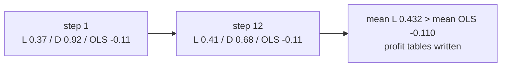

# Results

All cells in this section are taken from `docs/jepa-replenishment.md`, which `render_paper` writes from the run directory. Means are over 32 paired seeds unless a cell is marked otherwise. Profit is `net_profit / initial_cash`. Six decimal places match the draft. A blank operational cell was blank in the draft. An arm that is absent from a profit table was omitted by `collinear_report` because its per-seed profit correlated above 0.99 with an arm that the table kept. The omitted series are named in the warning lists. They are not given means in the protocol parquets, and this paper does not invent those means.

The in-distribution latent mean is the one place a learned profit is available on the same seeds by another route: the holding-rate sweep at 0.01 rescores seeds 13000000–13000031 and keeps the latent column, because the only other arm in that file is the ceiling. That cell is reported with the sweep, and it is the learned profit the in-distribution table is missing.

## 1. Training log

`collect_transition_log` wrote 896 episodes at holding rate 0.01, seeds 14000000–14000895, ticks 1–364. The mixture is 64 episodes each of order-up-to, reorder point, periodic order-up-to, periodic reorder, exploratory, and never-order, plus 512 over-order episodes. The fraction of transition rows with a non-zero order is 0.146410. Of the rows, 0.418 have on-hand zero, 0.207 sit on a shelf that is at least half full, 0.023 are capacity-bound, and 0.384 are cash-bound. Cash stops orders far more often than the shelf does, under this mixture.

The fit used those rows. The loss curve, the early-stopped epoch, and the validation loss are written under `runs/jepa-replenishment/fit/` and are not in the repository, so they are not reported.

## 2. Held-out rollout accuracy

The gate compares the mean, over the 12 planning steps, of per-step R². Each step's R² is the mean of the on-hand, arrival-profile, and sales R² on the latent fit's validation episodes. Actions in the rollout are the filled quantities from the log, not the planner's orders.

| Step | Latent | Direct | Least squares |
| --- | --- | --- | --- |
| 1 | 0.368218 | 0.919635 | −0.113529 |
| 2 | 0.451315 | 0.784160 | −0.112925 |
| 3 | 0.457716 | 0.769770 | −0.112317 |
| 4 | 0.454601 | 0.752939 | −0.111704 |
| 5 | 0.450153 | 0.742439 | −0.111108 |
| 6 | 0.446080 | 0.732054 | −0.110522 |
| 7 | 0.439383 | 0.723257 | −0.109952 |
| 8 | 0.433938 | 0.712832 | −0.109379 |
| 9 | 0.429128 | 0.703989 | −0.108821 |
| 10 | 0.423438 | 0.694810 | −0.108236 |
| 11 | 0.418161 | 0.688063 | −0.107675 |
| 12 | 0.412300 | 0.680391 | −0.107112 |
| Mean | 0.432036 | 0.742028 | −0.110273 |

The latent mean is above the least-squares mean, so `rollout_beats_baseline` opened and the profit tables were written. The direct predictor is more accurate at every step. Its advantage is largest at step 1 (0.920 against 0.368) and shrinks as the rollout lengthens, and it is still ahead at step 12 (0.680 against 0.412). Least squares is below zero at every step: the open-loop linear rollout is worse than predicting the validation mean. On the separate 112-episode measurement log the same least-squares procedure scored about 0.36 and the latent model about 0.12, so the sign of the comparison is a property of the log it is measured on. The published gate opened because the latent model reached 0.43 and because least squares on this log fell below zero.

The latent curve rises from step 1 to step 3 and then declines slowly. The direct curve declines from the first step. Both are open-loop. The latent model was trained to match codes for 12 steps; the probe that produces these R² values was trained one step at a time on stopped target codes. The direct model was trained one step at a time on the quantities themselves and is rolled forward by feeding those quantities back.

## 3. In-distribution

Seeds 13000000–13000031, training SKUs, default disruption, holding rate 0.01. The pass rule is: the learned arm beats the tuned anchor on paired `net_profit / initial_cash`, and the bootstrap interval of latent minus that anchor lies entirely above zero. The draft reports the rule as unavailable, because the latent column was omitted from the parquet.

| Arm | Mean profit | Order volume | Service level | Stockout rate | Fill rate |
| --- | --- | --- | --- | --- | --- |
| Never-order | 0.348522 | 0 | 1.000000 | 0.585385 | nan |
| Random cover | 0.305812 | 13997.25 | 1.000000 | 0.246437 | 0.479018 |
| Oracle in the planner | 0.912643 | 3177.19 | 1.000000 | 0.512749 | 1.000000 |
| Tuned order-up-to anchor | 1.021222 | 12898.66 | 1.000000 | 0.155463 | 1.000000 |
| Default order-up-to | 0.835168 | 13612.56 | 1.000000 | 0.134528 | 0.999909 |
| Periodic order-up-to | −0.030309 | 14101.91 | 1.000000 | 0.166642 | 0.999028 |

The tuned anchor is the best arm the table keeps. The gap from the anchor to never-order is 0.673. The gap from the anchor to the default order-up-to rule, which uses cover 14, safety one third of lag, and no stockout bonus, is 0.186. Tuning on this world moves profit. The oracle recursion inside the same planner scores 0.913, which is 0.109 below the anchor, on about a quarter of the anchor's order volume (3177 against 12899) and with a stockout rate of 0.513 against the anchor's 0.155. Random covers order the most (13997) and earn less than never-order (0.306 against 0.349). Periodic order-up-to at its default parameters earns −0.030.

Service level is 1 on every reported arm. Stockout rate is not: never-order is empty at the decision on 59 percent of SKU-ticks, the anchor on 16 percent, the oracle on 51 percent. Fill rate is 1 for the anchor and the oracle, about 0.48 for random covers, and undefined for never-order because that arm places no order.

On these seeds the sweep in section 6 reports latent profit 0.381458. That is 0.033 above the never-order mean in the table above and 0.640 below the anchor. The warning file gives the seed-wise correlations that removed the learned columns:

- never-order with latent 0.9987, with direct 0.9956, with permutation 0.9987, with fair share 0.9987, with least squares 1.0000
- latent with direct 0.9971, with permutation 1.0000, with fair share 1.0000
- order-up-to with reorder-point 0.9980, with periodic reorder 0.9942

Least squares inside the planner is the same series as never-order on these seeds. Permutation priority and fair share are the same series as latent. The direct planner is not bit-identical to latent (correlation 0.9971, not 1) and is still not a distinct comparison under the 0.99 rule. Reorder-point and periodic reorder are not distinct from default order-up-to. The arms a reader can actually compare on this protocol are never-order, random cover, the oracle, the tuned anchor, default order-up-to, and periodic order-up-to.

## 4. Unseen SKUs

Seeds 15000000–15000031, the 150 evaluation SKUs, default disruption, holding rate 0.01. The predictor is not fit again.

| Arm | Mean profit | Order volume | Service level | Stockout rate | Fill rate |
| --- | --- | --- | --- | --- | --- |
| Never-order | −0.331425 | 0 | 0.968750 | 0.560799 | nan |
| Random cover | 0.031361 | 12417.88 | 0.968750 | 0.241893 | 0.438648 |
| Oracle | 0.385389 | 3554.50 | 0.968750 | 0.476367 | 1.000000 |
| Tuned anchor | 0.595378 | 10952.63 | 0.968750 | 0.157641 | 0.999883 |
| Default order-up-to | 0.414247 | 11535.06 | 0.968750 | 0.134117 | 0.999926 |
| Periodic order-up-to | −0.611453 | 12191.44 | 0.968750 | 0.127555 | 0.995359 |

The anchor remains the best reported arm, at 0.595 against 1.021 on the training SKUs. Never-order falls from 0.349 to −0.331, so opening stock alone does not carry the held-out assortment. Random covers, which lost to never-order on the training SKUs, now beat never-order (0.031 against −0.331) and remain far below the anchor. The oracle (0.385) sits next to default order-up-to (0.414), both below the tuned anchor. Service level is 0.96875 on every arm, which is the same value to the printed precision and is consistent with one seed in 32 failing to fill demand. Stockout rates still separate the arms.

The learned columns were omitted. Never-order correlates with latent at 0.9997, with direct at 0.9917, with permutation at 0.9996, and with fair share at 0.9997. Least squares again matches never-order at 1.0000. Latent matches permutation and fair share at 1.0000 and direct at 0.9929. The anchor correlates with periodic reorder at 0.9906, so that default periodic rule is not a separate result on this split.

## 5. Unseen disruption

Seeds 16000000–16000031, training SKUs, harsh disruption: event probability 0.2, severity 0.2, duration 21 days, types including pandemic and political unrest. The log never samples this regime.

| Arm | Mean profit | Order volume | Service level | Stockout rate | Fill rate |
| --- | --- | --- | --- | --- | --- |
| Never-order | −0.556331 | 0 | 1.000000 | 0.351368 | nan |
| Random cover | −0.479452 | 4397.47 | 1.000000 | 0.065798 | 0.691967 |
| Oracle | −0.380010 | 918.44 | 1.000000 | 0.297757 | 1.000000 |
| Tuned anchor | −0.359757 | 3286.19 | 1.000000 | 0.066800 | 1.000000 |
| Periodic order-up-to | −0.628451 | 4430.75 | 1.000000 | 0.032903 | 0.999758 |

Every reported arm loses money. The tuned anchor is the least negative, at −0.360. The oracle is close, at −0.380, on 918 units against the anchor's 3286. Random covers and periodic order-up-to lose more than the anchor and more than never-order's −0.556 in the periodic case (−0.628). Order volume is much smaller than in distribution: the anchor's 3286 units against 12899. Fill rate for random covers rises from 0.48 in distribution to 0.69, which is what a smaller order against the same suppliers looks like. Service level is again 1. Stockout rates fall relative to the in-distribution table, with the anchor at 0.067 against 0.155.

Default order-up-to, reorder-point, and periodic reorder were omitted because they correlate with the anchor or with each other above 0.99 (anchor with order-up-to 0.9965, with reorder-point 0.9972, with periodic reorder 0.9972). The learned arms were omitted because they correlate with never-order: latent and permutation and fair share at 0.9971, direct at 0.9976. Least squares matches never-order at 1.0000. Latent matches direct at 0.9991 and matches both alternative rations at 1.0000.

## 6. Holding-rate sweep

The same latent weights, retargeted with `ReplenishmentPlanner.retarget`. No new log. Seeds 13000000–13000031 at each of 0.005, 0.01, 0.02, 0.05, and 0.1. The ceiling is the order-up-to policy whose `best_params` were selected at that same rate. The draft contains a curve, so `assert_order_sequences_differ` did not fire: the frozen planner's orders are not identical across the five rates.

| Holding rate | Ceiling | Latent | Paired interval, latent minus ceiling |
| --- | --- | --- | --- |
| 0.005 | 1.351098 | 0.604627 | −1.306742 to −0.279629 |
| 0.01 | 1.021222 | 0.381458 | −1.185105 to −0.184952 |
| 0.02 | 0.425762 | −0.072456 | −1.019959 to −0.043683 |
| 0.05 | −1.385574 | −1.406850 | −0.344415 to 0.426941 |
| 0.1 | −3.547822 | nan | nan to nan |

At 0.005, 0.01, and 0.02 the interval lies entirely below zero. The frozen planner earns less than the rule tuned at that rate, by 0.746, 0.640, and 0.498 in the mean. At 0.05 both arms are near −1.4 and the interval covers zero; the mean gap is 0.021. At 0.1 the draft's learned mean and interval are not finite. The warning file still records that, at 0.1, ceiling and latent correlate at 0.9984. Those two statements sit side by side in the published artifacts. This paper does not replace the non-finite cell with a number.

The ceiling at 0.01 is 1.021222, the same value as the in-distribution anchor, which is the same policy on the same seeds. The latent value at 0.01 is the learned profit on those seeds. Both series fall as the holding rate rises. The ceiling falls faster in absolute terms from 0.005 to 0.05 (1.351 to −1.386) than it does in the gap to the latent arm, and by 0.05 the gap is inside the noise of 32 seeds. The search `best_value` at each rate, which is not a holdout mean, was 1.910, 1.064, −0.522, −4.995, and −12.514. The holdout ceilings are 1.351, 1.021, 0.426, −1.386, and −3.548. Search and holdout agree in sign and in the ranking of the rates. They do not agree in magnitude at the extremes: the search objective at 0.1 is −12.5 against a holdout mean of −3.5.

The sweep does not reprint order volume. The protocol tables that would have carried latent order volume omitted the column. The evidence that orders changed is the existence of the curve, not a published count of units.

## 7. What the ablations can and cannot say

The design scored four learned variants: latent with density priority, latent with a random permutation, latent with textbook fair share, and the direct network with density priority. On every generalisation protocol the two alternative rations correlate with density priority at 1.0000 or 0.9999. They are one policy. The direct network correlates with the latent network between 0.9929 and 0.9991. Under the written rule it is not a second policy either, despite being the better forecaster in section 2.

Least squares inside the planner correlates with never-order at 1.0000 on all three protocols. A linear model of the quantities, rolled the way the direct model is rolled, and then searched with the same covers, produces the same profits as buying nothing.

The oracle is distinct. It is also below the tuned anchor on every protocol where both appear: by 0.109 in distribution, by 0.210 on unseen SKUs, and by 0.020 under harsh disruption. Using an exact pipeline with a frozen censored rate and a 12-step window does not recover the profit of a tuned order-up-to rule that acts on all 365 days.

## 8. Scaling measurement, separate from the published fit

The README records a capacity curve on the 112-episode, 48-tick measurement log, at learning rate `1e-4`:

| Parameters | Latent mean rollout R² on that log |
| --- | --- | --- |
| 683,276 (width 256, depth 4) | 0.124 |
| 1,072,908 | 0.119 |
| 1,889,292 | 0.098 |

Least squares on that same log is 0.358. The data curve at width 256 is −0.148, −0.012, 0.007, and 0.124 at 28, 56, 84, and 112 episodes. The published 896-episode fit is a different number, latent mean 0.432, and is the one that cleared the gate. The notebook execution printed `capacity_points 5` and `data_points 4` from local curve files. Those files are not committed, so the other widths on the grid `(32, 2)`, `(128, 3)`, `(384, 3)`, `(512, 3)` do not have published R² values beyond the statement that 256 by 4 was the peak inside the band that was searched.

## 9. M5

`PINNED_ITEM_IDS` is empty. The run has no `m5/exam.parquet`. There is no zero-shot profit and no 2015-adaptation profit. The protocol in `replay_exam` remains as specified in the methodology and is not a result of this run.
