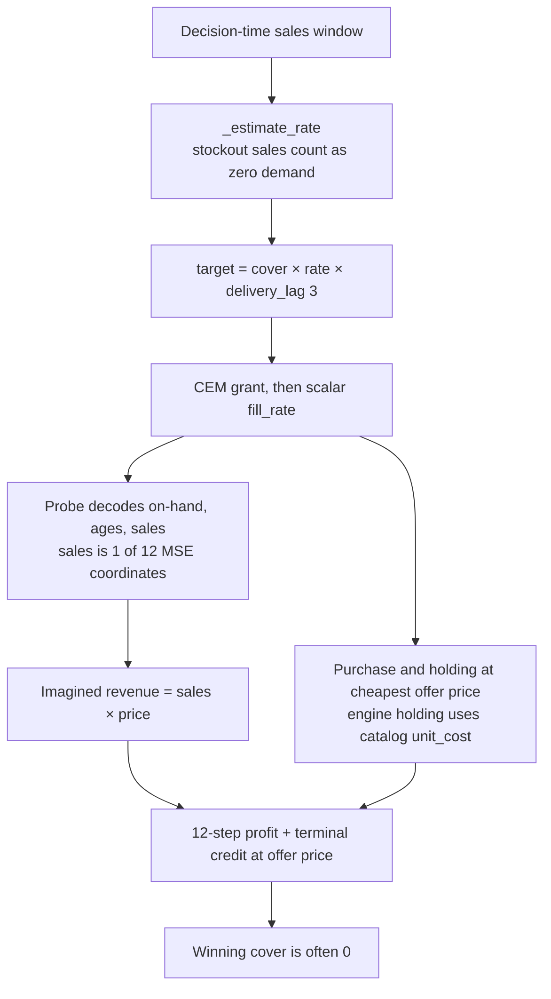

# Discussion

The rebuilt world has headroom, and the learned buyer does not take it. On the training products, at the holding rate the model was fit for, a tuned order-up-to rule earns 1.021 `net_profit / initial_cash`. Buying nothing earns 0.349. The gap is 0.67. Tuning the same family, from the default order-up-to rule at 0.835 to the anchor at 1.021, is worth 0.19 of that gap. The latent planner on those same seeds earns 0.381. That is a small step off never-order and a long step short of the anchor. The seed-wise correlation with never-order is 0.9987, which is why the table the pass rule reads does not contain the learned arm, and why the draft reports the pass as unavailable. The same pattern holds for products the log never saw and for a disruption regime the log never sampled: the learned series is kept out of the file because it tracks buying nothing, and buying nothing is a poor policy once opening stock is not enough (unseen SKUs, −0.331) or demand is repeatedly shocked (unseen disruption, −0.556).

The holding-rate sweep is the part of the claim that is actually measured. The curve was written, so the frozen orders are not the same list of purchases at every rate. Imagined cash and the holding term are doing something. They are not doing enough. At 0.005, 0.01, and 0.02 the bootstrap interval of latent minus the rate-specific anchor lies entirely below zero. At 0.05 the two policies are both losing about 1.4 and cannot be separated with 32 seeds. At 0.1 the published learned mean is not a number. Transfer, in the sense that would support the claim, would be the frozen planner meeting or beating the rule that was allowed to retune. The sweep shows a planner that remains behind while both profit series fall.

What follows is an account of why a model that cleared its forecast gate still plans like a buyer that rarely orders, and of the measurements that would have to be replaced before the same claim could be tested again.

## The forecast gate opened on a weak baseline

Held-out rollout R² for the latent model averages 0.432 over 12 steps. The direct model averages 0.742. Least squares averages −0.110. The gate requires only that the latent mean beat least squares. It opened. Two facts sit next to that pass.

First, the direct model is the better forecaster at every horizon, by 0.55 at step 1 and by 0.27 at step 12, and its profit series is still collinear with never-order (0.9956 in distribution, 0.9917 on unseen SKUs, 0.9976 under harsh disruption). Quantity accuracy and the decision are separating. A planner that reads a sharper one-step sales forecast is placing orders whose profits track an empty order. The architecture comparison the study advertised, latent codes against a direct predictor of the same width, is not identified in the profit tables. It is identified in the rollout curve, and there the latent model loses.

Second, least squares is a low bar on this log because its open-loop rollout falls below the validation mean. On the 112-episode measurement log the same procedure scored about 0.36 while the latent model scored about 0.12, and that fit was correctly refused. The published gate opened in part because the linear baseline got worse as the log got larger and more non-stationary, not only because the latent model got better. Beating a diverging linear rollout is evidence that the network is a stabler open-loop predictor than `lstsq` on these features. It is not evidence that the predictions are good enough to buy with.

The training objective and the reported R² are also different objects. `LatentDynamics._open_loop_loss` matches stopped target codes. The probe that decodes on-hand, the arrival profile, and sales is fit afterwards, from those stopped codes, and its gradient does not enter the encoder (`fit_probes`). The R² the gate uses is the probe's decoding of the predictor's codes, rolled out for 12 steps. A code can be easy to match and awkward to read. The direct network never has that gap: it is trained on the 12 quantities. The step-1 gap, 0.368 against 0.920, is what that design produces. The planner never sees the code. It sees the probe. Revenue inside `_score` is predicted sales times price. That sales coordinate is one of twelve targets in an unweighted probe MSE, beside on-hand and ten arrival ages, so most of the probe fit is spent on the pipeline the revenue term does not read.

## Why the search can prefer to buy nothing

Several mechanisms in `ReplenishmentPlanner._score` push the imagined profit of a positive cover down, independently of whether the network is accurate. They are visible in the code and consistent with the tables. They are not isolated by an ablation the tables can read, because the ration ablations correlate with the main arm at 1.

The cover formula multiplies a censored rate by the model's delivery lag of 3. The rate is the mean of observed sales (`_estimate_rate`). Observed sales are zero when the shelf was empty. After the cold-start pilot, a SKU that has not sold has a target of zero for every cover, including cover 4. The textbook anchor adds `stockout_safety_bonus_pct_of_lag` when `_has_stockout` fires. The published anchor at holding rate 0.01 uses a bonus of about 0.10 of the lag, and a safety fraction of about 0.17. The planner does not. A buyer whose rate collapses on a stockout, and whose action set is a multiple of that rate, has no way to restock a product it has stopped seeing.

The training action is the filled quantity, which is right. The scalar the planner multiplies onto every grant is a single fill rate estimated on textbook rows (`_fill_ratio`). Supplier, lead time, and residual factory inventory do not enter it. An order that will in fact be cut, and an order that will in fact arrive whole, are imagined as the same fraction. The over-order arm is 512 of 896 episodes and exists so that the log contains fills. Excluding it from the ratio was necessary: a ratio dominated by unfilled over-order requests teaches the planner that a cover arrives empty, and the earlier tables were that failure (correlations of 1.0000 with never-order). The refresh that produced the current draft moved those correlations from 1.0000 to the range 0.9917–0.9997 and allowed the holding-rate curve to be written. The planner is no longer bit-identical to never-order. It is still not a different policy under a 0.99 cutoff, and the profit gap on the shared seeds is about 0.03. Changing which rows estimate the fill rate removed a hard failure mode and left the decision almost where it was.

Holding inside the imagination uses the cheapest offer's list price. Holding inside `profit_decomposition` uses catalog unit cost. The offer price is unit cost times a markup of at least 5 percent and, for the fast supplier, two extra speed premiums of 10 to 35 percent each. The planner therefore charges itself more to hold a unit than the world will charge. The terminal credit uses the same offer price, so unsold stock is also valued above catalog cost. The two biases are not the same: holding is paid every imagined step, and the credit is paid once, on the stock that remains at step 12. A unit that arrives late in a 12-step window is held for few steps and then credited at the inflated price; a unit that is bought and expected to sit is held at the inflated price for longer. Combined with a sales probe that does not increase sales when an order is placed, the arithmetic favours cover 0. The engine then evaluates the emitted order with the true, lower holding rate on catalog cost, but it can only evaluate the orders the search agreed to emit.

There is no stockout penalty. Lost demand appears only as sales the probe did not predict. If the probe's sales track the recent window, an order that would have prevented a future stockout does not increase imagined revenue, because the recent window already recorded the stockout as low demand. The purchase still decreases imagined cash. The 12-step horizon and the terminal credit were added so that an order's arrival would fall inside the window and so that leftover stock would not be confiscated. They do not impute the demand the shop failed to see.

The oracle is the cleanest evidence that the search, not only the network, is leaving money behind. `OracleDynamics` ages the true arrival profile, adds arrivals, and sells the minimum of stock and a frozen censored rate, with fill rate 1. On the in-distribution seeds it earns 0.913 against the anchor's 1.021, orders 3177 units against 12899, and is empty at the decision on 51 percent of SKU-ticks against the anchor's 16 percent. A recursion that knows the pipeline and still uses the censored rate, the cover set `{0, 1, 2, 4}`, and a 12-day imagination is not an upper bound on a 365-day order-up-to rule. Calling it a ceiling in the comparison writer overstates what it can certify. It does certify something: replacing the learned rollout with this recursion moves profit from the never-order region (0.38) into the region of the default textbook rule (0.84), and stops short of the tuned rule. Part of the gap is the model. Part of the gap remains when the model is removed.

Least squares inside the same search correlates with never-order at 1. A bad open-loop linear model plus the cover search is indistinguishable, in profit, from buying nothing. That is the failure mode the first study hit with an untrained network. It is still available to any predictor whose decoded sales do not respond to the grant.

## The reporting rule hides the comparison it was meant to protect

`collinear_report` drops the later of two arms when per-seed correlation exceeds 0.99. The rule was added because a previous run printed three learned arms whose profits correlated at 0.9999 and differed by at most a few hundredths, and those columns were being read as ablations. On this run the rule is doing that job for permutation versus fair share versus density priority: those correlations are 1.0000, and printing them as three buyers would be misleading. It is also doing a different job to the pass rule. Pearson correlation does not see a constant gap. A buyer that earned exactly 0.03 more than never-order on every seed would correlate at 1 and would be deleted, and `in_distribution_passes` reads the parquet after the deletion. The sweep, which never contains a never-order column, is the only published place the latent mean survives. The pass rule and the profit table are not looking at the same object.

The practical consequence is that the paper's main table cannot answer "by how much did the learned buyer beat buying nothing?" A reader who subtracts 0.348522 from 0.381458 is using two files that happen to share seeds, and is assuming the never-order mean in the protocol parquet and the latent mean in the sweep are paired. They are the same seeds and the same holding rate. They are not a paired interval. The interval the draft does publish, latent minus the anchor at 0.01, is −1.185 to −0.185. That interval is the one that matches the claim, and it excludes zero on the side of a loss.

Order volume, service, stockout rate, and fill rate for the learned arm are not in the published protocol tables, because the arm was dropped before `_operational` ran. The sweep printer in `paper.py` writes profit means and the paired interval and does not write the operational columns. So the published record does not say how many units the frozen planner ordered, at any rate. The statement "orders changed across holding rates" is the absence of `holding_rate_sweep_refused.json`. It is a true statement about identity of sequences. It is not a statement about the size of the change.

## What the operational columns say about the world

Service level is 1.000 on every in-distribution arm that was printed, including never-order, and 1.000 again under harsh disruption. On unseen SKUs it is 0.96875 on every arm. A metric that does not move when order volume moves from 0 to 14,000 is not measuring the service consequence of the policy. The definition explains the pattern without making the column useful. `business_metrics` divides units the shop shipped by units requested from the shop. `stockout_rate` is the fraction of SKU-ticks with decision-time on-hand equal to zero, including ticks on which nobody asked for the product. A dead or declining SKU (`stage_factor` 0.05 or 0.2) with an empty shelf raises the stockout rate and contributes nothing to the service ratio. Decision-time on-hand is also recorded before receipts, so a tick can be flagged as a stockout and still sell goods that arrive later in the tick. The stockout column does move, and it moves in the direction a replenishment study cares about: the anchor is empty less often than never-order (0.155 against 0.585 in distribution) and less often than the oracle (0.513). Future tables should publish lost sales, units of demand the sinks generated and did not buy, computed from `demand_target` rather than from the shop's outgoing fill.

Fill rate separates random covers (0.48 in distribution, 0.44 on unseen SKUs) from the textbook rules and the oracle (at or extremely near 1). Random covers request about 14,000 units and suppliers fill about half. The anchor requests about 13,000 and is filled. The difference is not the supplier. It is the shape of the request: a cover drawn uniformly from `{0, 1, 2, 4}` every tick, with a random priority, asks for more than the factories and the cash account will ship. The oracle requests 3,200 and is filled completely. Scarcity is real for a buyer that over-asks, and it is not binding for a buyer that asks for a tuned order-up-to quantity. A world model trained mostly on over-order residuals (512 of 896 episodes, non-zero order fraction 0.15) spends its capacity on a region of the action space the winning policy does not occupy.

Cash-bound rows are 38 percent of the log and capacity-bound rows are 2 percent. The shared shelf was supposed to force a cross-SKU ration. Under the behaviour mixture, cash is the constraint that bites. Density priority, fair share, and a random permutation all correlate at 1 in profit. That is what a ration comparison looks like when the ration is rarely the binding constraint, or when every ration is applied to a desired quantity that is already zero. The study cannot claim that marginal-profit priority beats fair share. It can claim that the experiment did not put those rules in a state where they diverge.

## Generalisation

Unseen SKUs are a real shift. Never-order changes sign. The anchor drops from 1.021 to 0.595 and remains the best reported policy. The oracle drops from 0.913 to 0.385 and lands on top of the untuned order-up-to rule. The catalog split is a stride through a demand mean that runs from 0.5 to 40, with margin, coefficient of variation, and lifecycle tempo scrambled by modular hashes. The encoder never sees a product identity. It sees on-hand, a pipeline, a sales window, cash, capacity, and a nominal lag. In that feature set, a new SKU is a new scale of the same vector. The learned buyer does not exploit that. Its profits track never-order at 0.9997, and never-order is now a losing policy. Reporting "no learned row" is accurate to the file and easy to misread as "the protocol was not run." The protocol was run. The result is that the learned policy inherited the failure mode of buying nothing, on products whose opening stock does not pay the bills.

Unseen disruption is a harsh shift: shocks of severity 0.2 lasting 21 days, arriving with probability 0.2, including types the log does not contain. The encoder does not see the event. It can see the event only through sales and inventory after the fact. Every reported policy loses money. The anchor's advantage over the oracle shrinks to 0.020, and its advantage over random covers is about 0.12. Order volumes fall by a factor of about four relative to the calm world. In a year dominated by long, deep demand collapses, a 12-step imagination and a 365-day order-up-to rule are closer to each other than either is to a profit. The protocol is not future work; it was scored. It does not show a model-based buyer adapting to a regime its features omit. It shows a world in which the best textbook rule still loses, and the learned rule is omitted because it matches the worst of the simple baselines.

The sweep's non-finite cell at holding rate 0.1 should be treated as a missing comparison, not as a tie. The warning says the series correlates with the ceiling at 0.9984, which would mean the two policies rose and fell together across seeds while the draft failed to print a mean. A rerun that writes the per-seed column, finite or not, is required before anyone interprets the high-rate end of the curve. The search objective at that rate (−12.5) and the holdout ceiling (−3.5) already disagree by a factor of about three, so the tuned anchor at 0.1 is itself an unstable target. Thirty-two seeds with a log-uniform cash tightness from 0.02 to 0.8 will contain episodes where a 10 percent holding charge on a large opening inventory dominates the mean. Those episodes need to be shown, not averaged away. The parquet schema already has `tightness` and `cash_tightness` per seed (`_comparison_frame`). The draft never aggregates them. That is the stratification the cash-bound fraction is asking for.

## Design choices that limit what a positive result would have meant

Even a planner that beat the anchor on these 32 seeds would have left the following open.

The model is one SKU at a time. Cash and capacity are copied onto every row, and the predictor is not trained to decide which SKU should receive the next unit of either. Priority is a side calculation: one extra rollout per SKU with a forced grant of a single unit and with later orders suppressed (`_density_order`). Interactions, substitution through the lifecycle, and the effect of one order on the cash the next SKU sees inside the same tick are outside the code. The ration ablations collapsing is consistent with that structure.

The fit's delivery lag is 3. The log's nominal lag is drawn from 2 to 6, and edge leads add 0, 2, or 4. The unroll and the cover formula use 3. The last feature carries the episode's nominal lag, so the network can in principle condition on it, and the planner's target quantity ignores the edge lead of the supplier it is about to buy from. A fast, expensive supplier and a slow, cheap supplier are imagined on the same 12-day clock. Cheapest-first routing, shared with the anchor, then spends the order on the slow offer. The anchor's `s` and `S` use the per-product lead time inside `MultiSupplierTextbookPolicy`. The planner's cover uses `self.delivery_lag`.

The horizon is 12 days in a 365-day episode. The terminal credit is a linear salvage at offer price. There is no experiment in the published run with `horizon_multiple` in `{1, 2, 8}` or with the credit removed. The first study showed that a horizon equal to the lead time makes the model irrelevant. This study shows that a horizon of four lead times, plus a salvage term, is not sufficient for the learned model to approach a tuned rule. It does not show which of the horizon, the salvage price, the censored rate, or the probe is the binding constraint. Those are one-flag changes to `ReplenishmentPlanner` and `OracleDynamics`.

The behaviour policy that generated the log is not the behaviour policy scored as the random floor. Log exploratory episodes draw a planning depth from 1 to 30. The evaluation random arm uses depth equal to delivery lag 3 and `policy_seed` 0. Over-order, which is most of the log, has no counterpart in the comparison table except insofar as random covers also over-ask. The never-order arm in the table is a fresh `NeverOrderPolicy`, which is the same decision as the log's never-order arm, so that row is comparable. The random row is a specific policy, and the paper should not describe it as the training distribution.

Only order-up-to was tuned, and only its three parameters. Reorder-point and both periodic rules appear at class defaults and then collapse into each other or into the anchor whenever the world is harsh. Periodic order-up-to is the one default rule that stays distinct, and it earns −0.030 in distribution and −0.611 on unseen SKUs. That is a useful negative control for "a textbook name is not a competent buyer." It is not a tuned member of the family. A claim about the textbook family is a claim about the tuned order-up-to rule plus a set of defaults.

Sample size is 32 paired worlds. The intervals at low holding rates are wide and still exclude zero, so the loss there is not an artifact of a single seed. The interval at 0.05 covers zero and is about 0.77 wide. Tightness, assortment size, and lag are redrawn inside each seed. Thirty-two draws from that mixture cannot support a statement about high-cash episodes separately from low-cash ones. The bootstrap (`paired_interval`, 1000 resamples, seed 0) is the right instrument for a paired mean. It is being asked to summarise a mixture.

The five tuning studies record an older git SHA than the log, and the log's SHA is older than the fill-rate change that `apply_logged_fill_rate` now performs at evaluation. The studies were reused because their episode distribution matched. The profit tables are the post-refresh draft, not the draft in which every learned correlation was 1. A third party can rebuild worlds from seeds and catalog hashes. They cannot rebuild the weights or the per-seed profit file from the repository, because `runs/` is untracked. The means in the results section are the scientific record. The checkpoints are not.

## M5

The replay exam was not run. Item ids were never pinned. There is no basis for a statement about Walmart sales. The protocol as written would also have answered a narrower question than the synthetic study. Factories are given inventory and production of 100,000, so they do not stock out. The world is flat. Unit cost is 40 percent of median price for both buyers. Five items share a shop. That is a test of whether a network trained on the synthetic mixture can order against a replayed demand path, and of whether refitting on 2015 reward-free transitions moves 2016 profit relative to an anchor tuned on 2015 profit. It is not a test of scarce multi-supplier routing. Both questions are worth answering, and neither has a number. Until `data/m5/` is present and `replay_exam` writes `exam.parquet`, the external validity of the synthetic failure is unmeasured. A failure on the synthetic world is already informative. A success on five grocery series with unlimited upstream stock would not have repaired the synthetic result.

## What would make the claim testable

The next experiment has to show a learned order stream that is visibly different from never-order before it is allowed to claim a comparison with the anchor. Concretely:

1. Publish, for every arm including those above correlation 0.99, the mean profit, the mean gap, the correlation, and the order volume. Keep the warning. Stop deleting the column the pass rule needs. `collinear_report` can flag; `in_distribution_passes` has to see latent and the anchor.
2. Count orders. Per seed, report the number of ticks with a positive order, total units requested, and total units filled, for latent, direct, oracle, and the anchor. The sweep's order sequences already exist inside `holding_rate_sweep` before the mean is taken. Write them.
3. Align the planner's costs with the engine. Charge holding and the terminal credit at catalog unit cost, the same `unit_cost` `profit_decomposition` uses. Re-score the current checkpoint before refitting. If the orders move, the offer-price proxy was part of the refusal to buy.
4. Give the planner the stockout bonus the anchor already has, or replace `_estimate_rate` in the cover formula with a rate that does not treat a zero-sale stockout as zero demand. The oracle should get the same rate, so a remaining gap is the horizon and the cover set rather than a second copy of the censoring bug.
5. Make fill a function of the decision. The minimum change is to condition the predictor on the supplier and the edge lead, and to stop multiplying every SKU by one log-wide scalar. The oracle's fill rate of 1 is the other extreme; a table of realised fill by supplier rank on the log would show whether a scalar is even a stable summary.
6. Train the quantity the planner reads. Either remove the stop-gradient on the probe for a controlled refit, or select checkpoints by validation quantity R² rather than by latent MSE. The direct model is already the quantity-trained control. It should be reported as a profit number even when it correlates with latent.
7. Set the unroll and the cover lag to the episode's nominal lag, and the imagined arrival to the edge lead of the supplier `_place` actually selects. Lag 3 is a convenient default from `fit_latent` and it is not the lead time of the cheapest offer.
8. Replace the 12-step salvage with a small grid: horizon multiples 1, 4, and 8, credit on and off, on the oracle first. The oracle is cheap relative to a refit and, on the current numbers, is the model that moves profit. If the oracle still cannot beat the tuned anchor at a longer horizon, the cover set and the censored rate are the constraint. If it can, the learned probe is the constraint.
9. Stratify the 32 seeds by cash tightness and capacity tightness, and increase the holdout until each bin has a paired interval. The columns are already on the frame.
10. Retune the anchor if the planner's cost alignment changes the world the anchor was tuned in. The current studies are valid for the world as simulated. They are not valid for a world in which holding is computed differently. `best_value` must stay labelled as a search objective; the holdout mean is the number to cite.
11. Run the M5 exam, and report it as descriptive. Separately, a scarce-supply version of that shop would be a different experiment.
12. Add one behavioural-cloning buyer that imitates the tuned anchor's orders from the same features, with no rollout. If cloning beats the planner and loses to the anchor, the search is the bottleneck. If cloning also tracks never-order, the features are the bottleneck. The present design cannot tell those stories apart, because every learned search lands in the same place.

The capacity curve on the small log was the right kind of measurement and the wrong log. It showed a peak at width 256 and a data curve that was still rising at 112 episodes. The published fit at that width, on 896 episodes, reached rollout R² 0.43 and still planned near never-order. Further width on the small log made R² worse, so a larger network is not the first change to try. A longer log might move the direct model's 0.74 toward something a search can use; the profit tables say the search does not currently use the accuracy it has.

## Conclusion

The study asked whether a per-SKU latent world model and a factored search could beat a tuned order-up-to policy, and whether the frozen weights would survive a new holding cost, new products, and a harsher disruption process. The world was repaired enough that tuning matters and that buying nothing is no longer optimal. The forecast gate was repaired enough that an untrained constant cannot publish a profit table, and on the full log the latent model does beat least squares. The planner was repaired enough that its orders are not identical at every holding rate and not bit-identical to an empty order.

On the published means, the tuned anchor is the best buyer in every protocol that reports it. The learned buyer, where its mean is visible, earns 0.381 against the anchor's 1.021 at the training holding rate, and the paired interval of that difference lies below zero. Where its mean is not in the protocol table, the reason is that its profits correlate with never-order above 0.99. The direct model forecasts better and plans the same way. The oracle plans better than the learned model and worse than the anchor. Those are the results the run supports. They do not support the claim the rebuild was designed to test.
